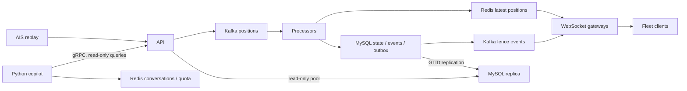

# Multi-Tenant Real-Time Location Tracking

A platform that turns vessel position reports into live fleet maps and durable port arrival/departure records for many logistics companies at once. Java 21 services accept positions through Kafka, keep the latest positions in Redis and confirm port crossings transactionally in MySQL, so crashes and replays never create a second arrival. WebSocket gateways push company-scoped updates and isolate slow clients. A Python copilot answers operators' questions in natural language through read-only API queries on a MySQL replica, and shows the executed conditions and result tables rendered by code. A personal engineering project with public AIS data, local and AWS benchmarks and a real-model evaluation — not a production deployment.



Every design is checked against stated [requirements](docs/requirements.md): 50 companies, 2,500 positions/s peak, 2,500 live connections, 2 s p99 delivery, two instances per service, 100 copilot questions per company per minute.

## Measured highlights

| Result | Conditions and evidence |
|---|---|
| **Copilot: 122/123 tasks solved (99.2%), review-corrected estimate; 0 cross-company disclosures** | Python copilot, `deepseek-flash`, 41 synthetic tasks × 3 on the local stack, including API outages, a lagging replica and follow-ups on another instance. Frozen checker 102/123; all 21 checker failures reviewed (20 false fails), 0 false passes in 25 sampled successes; 2.10 CNY. [Round 4 review](docs/review/round4-review.md). |
| **40,899 positions/s acknowledged ingest median [39,850–41,042]** | AWS, three trials, separate two-vCPU API and processor hosts, 261,255-row NOAA replay at max rate; API was the shared CPU constraint. Measured before the simplification; the laptop rerun below shows no measurable change. [Performance](docs/design/performance.md). |
| **5,000-client p99: 2,845→986 ms with a second gateway** | AWS, one→two two-vCPU gateways behind nginx, 1,000 positions/s, three 120-second trials per case, zero 429s; [resource evidence](docs/verification/aws-gate2-matrix.md). |
| **250/250 slow sessions terminated; zero normal terminations** | AWS, 5% of 5,000 clients paused, two gateways, three trials; laptop rerun after the simplification: 50/50 terminated, normal p99 427 ms vs 444 ms with no slow clients. |
| **Gateway live heap 579.4→396.5 MiB; p99 1,099→596 ms** | Laptop, 5,000 company-wide clients, three trials per build: serializing each company frame once instead of per connection; [WebSocket](docs/design/websocket.md). |
| **Simplification kept performance** | Laptop rerun of the same scenarios after removing redundant mechanisms: ingest 26,753 vs 27,437 positions/s, 5,000-client p99 648 vs 596 ms, within trial ranges; [Phase 9 table](docs/design/performance.md). |

## Design and evidence

- [Requirements](docs/requirements.md): scale assumptions, functional and non-functional requirements, and which design serves which requirement.
- [Architecture](docs/architecture.md): position and event flows, service boundaries and data ownership.
- [Ingestion](docs/design/ingestion.md), [geofence](docs/design/geofence.md), [consistency](docs/design/consistency.md): ordering, hysteresis, replay from MySQL and the transactional outbox.
- [WebSocket](docs/design/websocket.md), [resume](docs/design/resume.md), [tenancy](docs/design/tenancy.md): shared frames, bounded per-connection queues, active-tenant traffic and reconnect recovery.
- [Copilot](docs/design/copilot.md), [query transparency](docs/design/query-transparency.md): Python tool loop, server-side company scope, read-only replica queries, API-rendered conditions and tables.
- [Performance](docs/design/performance.md), [evaluation](docs/design/evaluation.md), [AWS](docs/design/aws.md): evidence, failed attempts and explicit limits.
- [Decision records](docs/decisions/README.md) (037–045 record the requirements-driven changes), [engineering journal](docs/journal.md), [historical verification reference](docs/verification/legacy-project-reference.md).

## Run locally

Requires JDK 21, Maven, Docker Compose v2, Python 3 and uv. From the repository root:

```bash
docker compose up -d --wait
mvn -B -ntp verify
(cd copilot && uv sync && uv run python gen_proto.py && uv run pytest)
```

Then follow the [local runbook](docs/runbook.md) to start the services and replay a small fixture. The copilot needs `DEEPSEEK_API_KEY`; without it, questions return 503.

## Boundaries

Kafka, Redis and MySQL run as single nodes (the replica serves reads only, without failover), so losing one of them interrupts service. Delivery is at-least-once; clients dedupe event IDs. For up to a minute after a port edit, crossings may use the previous geometry. Copilot answers can be up to 60 seconds behind live data and say how current they are. Company identity is a request field, not authentication; internal gRPC calls are unauthenticated. Port circles and reduced flapping are not labeled accuracy. Model costs are estimates from list prices, not invoices.
