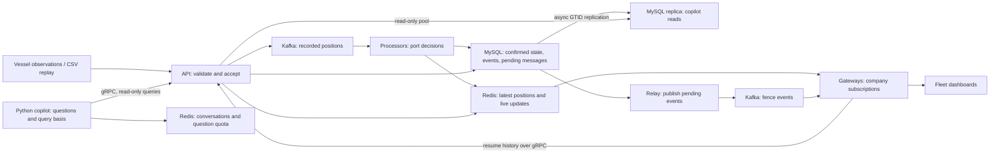

# Architecture

A fleet operator needs current vessel locations, stable port arrival/departure records and understandable answers about company activity. A replayer reads public vessel observations and sends batches to an API. The API validates company ownership and quotas, then records observations in Kafka. Processors update the latest map and evaluate port crossings, saving confirmed state and events in MySQL. Gateways deliver coalesced positions and distinct events to company-scoped WebSocket clients. Separately, a Python copilot turns questions into bounded, read-only API queries and shows the executed conditions and result tables, rendered by the API, before a short model summary. Scale, latency and availability targets are in the [requirements](requirements.md). This is a personal engineering experiment with local and separate-host AWS evidence, not a production fleet deployment.

## Components and separation

| Component | What it receives and produces | Why this boundary exists |
|---|---|---|
| replayer | Sorted AIS CSV observations → tenant batches; MMSI-hashed sequential lanes preserve each vessel's send order | Reproducible source pacing is independent of business processing. AIS is the vessel broadcast format; MMSI is its nine-digit identity. |
| api | HTTP positions/fence edits and internal data RPCs → Kafka records, owned SQL changes, typed data responses with rendered presentations | One service owns company/asset/fence data access and validates scope before storage queries. Copilot RPCs use a separate read-only pool on the replica. |
| processor | Kafka positions → Redis latest values and durable port confirmations; fence-change messages → refreshed index | Partition ownership controls transient geofence state; worker count can scale independently of acceptance. |
| gateway | Redis positions, Kafka events, client subscriptions → bounded WebSocket frames; reconnect requests → API history queries | Connection count, fan-out and slow transport resources are separated from processors. |
| copilot (Python) | Company-scoped questions → bounded tool loop over read-only API RPCs, API-rendered basis/tables and a model summary | The model is the least stable dependency; its memory, crashes and frequent prompt releases stay out of position processing (requirement N4.3). |
| common | Shared position/event types, proto, Lua quota mechanism and outbox implementation | A library and generated contract, not a deployed service. |
| loadtest | Scenario settings → WebSocket connections, bounded histograms/counters | Generator limits and received-data measurements remain separate from product behavior. |

Kafka is a durable record stream: producers append records and consumers resume from committed offsets. It separates acceptance from processing and permits replay. Redis holds fast current values and transient publish/subscribe channels; a disconnected subscriber does not get old messages. MySQL stores the confirmed business history. The outbox is a MySQL list of messages saved with the business transaction and sent later, closing the gap between saving an event and asking Kafka to deliver it.

## Synchronous and asynchronous communication

The copilot and gateway resume path need a bounded answer now, so they call the API using gRPC (one proto generates Java and Python code) with deadlines. The copilot retries a transient UNAVAILABLE read once inside its deadline; the proto has no write methods. Tenant scope is set by server code; service authentication is still out of scope.

Ingest waits only for Kafka acceptance. Position processing, pending-event publication and WebSocket delivery happen asynchronously. Redis pub/sub favors low-cost latest-position fan-out; it does not guarantee delivery. Kafka retains events, while API history reads enable bounded reconnect recovery. No atomic transaction spans HTTP, Kafka, Redis and MySQL.

## Data ownership

| Owner | Durable data / transient data | Readers and mutation boundary |
|---|---|---|
| API | tenant policies, registered assets, fences and the replication heartbeat in MySQL | API commands validate ownership; the copilot only reads, through RPCs served from the replica. |
| Processor | asset_fence_state and geofence_event in MySQL | Processor transaction writes; API exposes scoped read views. Processor startup/batch cache loads confirmed state through its mapper. |
| API and processor by topic | MySQL outbox | API inserts/relays fence-changes; processor inserts/relays fence-events. Shared code does not imply shared topic ownership. |
| Processor | Tenant latest-position hashes and GEO members in Redis | One Lua operation updates newer positions; API reads scoped views; gateways subscribe to active tenants. |
| Processor partition | last-ts, candidates and confirmed-state cache | Revocation/loss or failed persistence discards partition maps; MySQL rebuilds confirmed state. |
| Gateway instance/session | Subscription sets, pending/coalesced positions, mailboxes, event dedupe/ordering state | Connection lifecycle and sender workers; these are caches, not durable delivery logs. |
| Copilot | Conversation history (30-minute expiry, 6 turns) in Redis, keyed by tenant and conversation | Shared by all copilot instances; no direct fleet-table or fleet-Redis-key access. |
| Shared infrastructure exception | Copilot's per-company question token buckets in Redis | Copilot owns its quota keys, using the common atomic bucket script. |

## One position, in normal order

1. A CSV row supplies vessel identity, observation time and coordinates. The replayer stamps emittedAt while queuing it and chooses the vessel's lane and tenant batch.
2. The API marks ingestedAt at HTTP receipt before body decoding. It validates the batch, checks/registers owned assets and spends the tenant bucket. It enqueues all Kafka sends, waits for all acknowledgements under one deadline and returns acceptance.
3. The assigned Kafka partition consumer decodes the batch. Redis Lua reads/computes before writes and updates latest position, GEO and live channel only for newer timestamps.
4. Independently of Redis flags, the full decoded batch reaches the geofence engine. Unseen asset confirmed state is loaded in one SQL query. Newer observations advance entry/exit candidates.
5. Collected confirmations are saved in one MySQL transaction. Only successful processing/persistence advances the Kafka offset. A failure drops memory and replays from durable state.
6. Active-tenant gateways receive Redis positions, keep only the newest pending point per asset and flush batched frames. Company-wide recipients share one serialized frame; every connection has its own bounded sending queue. Intermediate observations can be coalesced away.

## One confirmed arrival, in normal order

An outside vessel supplies enough observations inside the enter radius over the required source-time interval. The engine collects ENTER at the confirming point with the fence version. The writer updates durable state, inserts the event and inserts pending publication in one transaction. The relay later locks eligible pending rows for fence-events, sends them and marks them published only after acknowledgements. Gateways receive their per-instance Kafka broadcast, filter absent tenants, dedupe event IDs and reject older/equal asset/fence timestamps, then enqueue immediately. A reconnect instead requests bounded database history with overlap and confirmed-seen IDs. Duplicate delivery is allowed; clients dedupe IDs.

## Important values and where they come from

| Value | Meaning and source | Where used / when absent |
|---|---|---|
| tenantId | Company scope from validated server request context or deterministic demo assignment | Every data request/write/filter. It is not in model tool schemas; production identity binding is not implemented. |
| assetId / mmsi | Internal vessel identifier; demo assetId equals the source MMSI | Kafka key, subscriptions, ownership, confirmed state and GEO member. Both are required in canonical positions. |
| positionTs | Observation instant from AIS, in epoch milliseconds | Redis newness, geofence order and event state guard; never a resume visibility cursor. |
| lat / lon | Source latitude/longitude in degrees | Validation, spherical fence distance and Redis GEO. Required. |
| sog / cog / heading | Optional source speed/course/heading | Preserved in current-position payload; absent if the report omitted them. They do not decide port membership. |
| emittedAt / ingestedAt | Generator queue time / API receipt time, epoch milliseconds | Secondary end-to-end / primary pipeline latency. Legacy payloads have ingestedAt=0 and are excluded from pipeline samples. |
| fence_version | Revision captured when a crossing is evaluated | Events record the revision used; for up to a minute after an edit it may be the previous one (N5.1). |
| event_id | SHA-256 of vessel, fence, transition type and source timestamp | SQL uniqueness and client dedupe. Not enough alone to prevent later-timestamp replay confirmation. |
| created_at / id | Database creation instant at microsecond precision and row identifier | Resume sort/cursor with overlap; allocation order is not a true commit sequence. |
| published_at | Time a relay transaction records acknowledged Kafka publication | NULL means pending. A send-before-mark failure leaves NULL and allows resend. |
| QueryReceipt / Presentation | Canonical validated arguments and database-resolved names / API-rendered model JSON, conditions, tables and data-as-of time | The copilot shows these; a result without a receipt fails closed. |
| replication_heartbeat.beat_at | Written on the primary every second | Read on the replica as data-as-of; older than 60 s makes copilot reads refuse. |

Start with the [design documents](../README.md#design-and-evidence), then [decision records](decisions/README.md) and [chronological journal](journal.md). The [local runbook](runbook.md) starts the system; historical measurements remain in verification reports.
