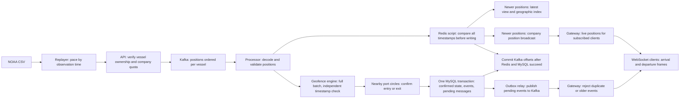

# Historical implementation and measurement reference

This relocated reference preserves previous phase results and operating details. Later reports and the frozen-checker ledger supersede earlier interpretations; original numbers remain visible. For current navigation, start with the repository README.

# Multi-Tenant Real-Time Location Tracking Platform

This is a learning and portfolio project, not a production deployment. **Phases 1–6 and the Phase 5.5/6.1/6.2 additions are implemented, including the geofence engine (CORE 2), data consistency (CORE 4), WebSocket gateway (CORE 3), and tenant-scoped Ops Copilot (CORE 5).**

Three simulated logistics companies send vessel positions. A replayer reads public NOAA AIS vessel observations, assigns each vessel to a company, and sends those observations in their original time order at a configurable speed. The API checks company ownership and available ingest capacity, then waits for Kafka to acknowledge the positions. The processor reads Kafka batches, keeps newer positions in Redis, updates the company's geographic index, and broadcasts accepted updates. A repeated or older observation cannot move a vessel backwards in the latest-position view.

The processor also checks whether a vessel has entered or left a circular port area belonging to its company. It waits for repeated observations before confirming a change, so position jitter near a boundary does not repeatedly report arrivals and departures. Confirmed arrivals and departures are saved in MySQL and queued for Kafka delivery in the same transaction. A background relay publishes them to the `fence-events` topic. The API can create, update and soft-delete port circles; each change is saved with a version and queued for every processor to reload. A WebSocket gateway delivers live position batches and individual arrival/departure events to clients subscribed to their company’s vessels. Operators can also ask the separate copilot service about their fleet and save draft alert rules. A frontend viewer and notification delivery remain outside this phase.



Kafka is the persisted queue between acceptance and processing. Each position uses its vessel identifier (MMSI) as its Kafka key, so observations of the same vessel go to the same partition and one consumer processes them in Kafka order. Kafka order is arrival order; timestamps can still arrive out of order. The timestamp check prevents an older observation from replacing a newer one.

## Modules and completed scope

| Module | Implemented behavior |
| --- | --- |
| `common` | Validated Java record messages, JSON serialization, tenant assignment, topic and Redis key names |
| `replayer` | NOAA CSV parsing, stable sort by observation time, hash-partitioned sequential sending lanes, speed/max-rate control, per-tenant batches, HTTP retry, emit timestamps |
| `api` | Ingest, tenant ownership, fence CRUD, database-owned fleet queries/draft rules over internal gRPC, human rule confirmation, Flyway and fence-change relay |
| `copilot` | Separate Spring AI HTTP service, tenant-free tool schemas, bounded conversation memory, LLM quota, deadline/circuit-protected gRPC tools; no MySQL access |
| `processor` | Batch consumer, one Redis script per batch, strictly newer latest/GEO/publication, manual synchronous commits, poison-record DLT, capped infrastructure retry, partition-owned geofence state, grid lookup/hysteresis, MySQL confirmed-state restoration, batch state/event/outbox transaction, startup fence loading, broadcast updates and reconciliation, shared relay, metrics |
| `gateway` | Tenant-scoped WebSocket subscriptions, 64 registry shards, Redis position broadcasts, per-instance Kafka event broadcasts, dirty-session position batching, bounded isolated sends, duplicate/timestamp guards and metrics |
| `loadtest` | JDK WebSocket clients on virtual threads, subscription mixes, paused-client flow control, latency histograms and Kafka lag snapshots |

Eight demo port fences are seeded. Confirmed-state, event and outbox tables are used in Phase 3. Alert rules can be drafted and confirmed but are stored only; no rule evaluator or notification sender exists. The copilot supplies the scoped read tools; standalone query HTTP APIs remain outside this phase.

## Requirements and exact commands

Use JDK 21, Maven 3.6.3 or newer, Docker with Compose v2, `curl`, and `unzip`. Select JDK 21 in each terminal used below. Services run on the host, while Compose runs Kafka, Redis and MySQL. Commands below start in the project directory:

```bash
cd ~/Desktop/Multi-Tenant-Location-Tracking
export JAVA_HOME=$(/usr/libexec/java_home -v 21)
export PATH="$JAVA_HOME/bin:$PATH"
docker compose up -d --wait
mvn -B -ntp verify
```

On Homebrew, if `/usr/libexec/java_home` does not see the installed JDK, use `export JAVA_HOME="$(brew --prefix openjdk@21)/libexec/openjdk.jdk/Contents/Home"` instead. Integration tests start their own disposable Kafka, Redis and MySQL containers; they do not modify Compose data. `mvn test` runs the API/processor/gateway unit tests and compiles integration tests; **`mvn verify` runs both unit and integration tests** and creates the executable jars. Missing Docker is a test failure, never a silent skip.

Run the API in one terminal:

```bash
cd ~/Desktop/Multi-Tenant-Location-Tracking
java -jar api/target/api-0.1.0-SNAPSHOT-exec.jar
```

Wait for the API to finish its Flyway migrations, then run the processor in another terminal. The processor reads active fences from MySQL before its Kafka listener starts; it fails startup if this read fails:

```bash
cd ~/Desktop/Multi-Tenant-Location-Tracking
java -jar processor/target/processor-0.1.0-SNAPSHOT-exec.jar
```

Replay the tiny synthetic fixture, or download and replay a real daily file:

```bash
cd ~/Desktop/Multi-Tenant-Location-Tracking
java -jar replayer/target/replayer-0.1.0-SNAPSHOT-exec.jar replayer/src/test/resources/tiny-ais.csv 60 200

./scripts/download-ais.sh
java -Xmx4g -jar replayer/target/replayer-0.1.0-SNAPSHOT-exec.jar data/AIS_2023_01_01.csv 60 200
```

The replayer arguments are CSV path, speed multiplier, maximum positions per tenant batch, optional API base URL (`http://localhost:8080`), lanes (`1`), mode (`speed` or `max`), optional wall-clock switch time in seconds (`0` disables it), post-switch speed (`100`), and optional global offered positions per second (`0`, unrestricted). A nonzero offered rate spaces batches across all lanes and is useful for quota-free latency runs. A vessel always hashes to one sequential lane; lanes can send concurrently. `max` removes source-time pacing, while HTTP acknowledgements and tenant quotas still limit acceptance. It flushes partial batches after approximately 250 ms, even while waiting for the next observation. It stamps `emittedAt` when it queues a point. The API independently stamps `ingestedAt` when receiving the HTTP request, before reading its body. Pipeline latency uses client receipt minus `ingestedAt`; receipt minus `emittedAt` remains the secondary end-to-end measurement, including generator batching and retry delay. Retry reuses the original timestamps and payload. Large daily files require enough heap because the intentionally simple replayer loads and sorts all valid rows in memory. Reduce speed if HTTP quota retries dominate replay pacing.

Inspect health, metrics, and a fixture vessel's latest position:

```bash
curl -f http://localhost:8080/actuator/health
curl -f http://localhost:8081/actuator/health
curl -f http://localhost:8081/actuator/prometheus
docker compose exec redis redis-cli HGET tenant:1:asset:366000000:latest position
docker compose exec redis redis-cli ZCARD 'geo:{1}'
```

`docker compose stop` preserves local data. Replaying the same file into an existing Redis store intentionally filters observations whose timestamps are no newer. A fresh replay requires deliberately resetting test/demo data; normal demo commands do not reset it. The Phase 6 runner resets only the separate `fleetbench` environment described below.

Ports default to API 8080, processor 8081, gateway 8082, Kafka 9092, Redis 6379 and MySQL 3306. Environment overrides: `API_PORT`, `PROCESSOR_PORT`, `GATEWAY_PORT`, `KAFKA_BOOTSTRAP_SERVERS`, `REDIS_HOST`, `REDIS_PORT`, `MYSQL_URL`, `MYSQL_USER`, `MYSQL_PASSWORD`. Kafka's Compose advertised host address is `localhost:9092`; this setup is for host-run Java services.

## Port arrivals and departures (CORE 2)

A company wants to know when one of its vessels reaches a port and when it leaves. On startup, the processor loads the eight active demo circles from MySQL. When a decoded Kafka position arrives, the engine first checks its own last report timestamp for that vessel. An older or equal timestamp is ignored by the engine, even if its coordinates differ. A newer report is checked against nearby fences for that company. An arrival or departure is confirmed using the rules below and collected for the batch. The whole collection is passed to `TransitionSink` for its MySQL transaction and then counted. Only after successful persistence can the listener acknowledge the batch.

The grid divides latitude/longitude into configurable cells. Lookups read an immutable snapshot through a volatile reference without locking; rare put/remove operations build and swap a new snapshot under a writer lock. Each fence is registered in every cell touched by the bounding box of its **exit** circle. Looking up a position returns fences in that cell for its tenant; a haversine distance calculation then checks the actual circle. The engine also checks any fence for which the vessel is already inside or has a pending change. This catches departures when the next report jumps beyond all cells belonging to that fence. The index exposes atomic `put` (add/replace) and `remove` operations for a single fence. Phase 3 uses these when a fence change is broadcast or reconciliation finds drift.

In `hysteresis` mode, a vessel starts OUTSIDE. A point at or within the enter radius starts or continues a pending entry. Entry requires **both** N consecutive qualifying points and at least T of report time between the first candidate point and the current point. A contrary point resets that candidate. Once INSIDE, points remain inside until their distance exceeds the larger exit radius; exit uses the same count/time rules. The band between the two radii preserves confirmed state. Candidate time uses `positionTs`, not wall-clock replay duration, so speeding up replay does not change results. Duplicate/older points do not count or reset a candidate.

In `naive` mode, one point at/within the enter radius immediately enters and one point beyond that same radius immediately exits. This baseline deliberately has neither the radius band nor the count/time confirmation, making boundary jitter visible for comparison.

| Configuration | Default | What it controls |
| --- | --- | --- |
| `geofence.mode` / `GEOFENCE_MODE` | `hysteresis` | Selects the immediate `naive` baseline or confirmed `hysteresis` decisions at startup. |
| `geofence.confirmation-points` / `GEOFENCE_CONFIRMATION_POINTS` | `3` | Minimum consecutive qualifying reports; only hysteresis uses it. |
| `geofence.confirmation-time` / `GEOFENCE_CONFIRMATION_TIME` | `120s` | Minimum elapsed **report time** from the first candidate; only hysteresis uses it. AIS reports can be minutes apart. |
| `geofence.cell-size-degrees` / `GEOFENCE_CELL_SIZE_DEGREES` | `0.05` | Cell width and height in longitude/latitude degrees, about 5.6 km north/south. Longitude width in meters varies with latitude. |

### Demo fences

These are illustrative circles around approximate harbor/terminal coordinates, **not official port boundaries**. Port names are listed by [USACE's Principal Ports dataset](https://services7.arcgis.com/n1YM8pTrFmm7L4hs/arcgis/rest/services/Principal_Ports/FeatureServer). Centers and radii are demo design choices; a circle does not cover an entire multi-terminal port. The Port Newark anchor follows the terminal location in [NYSERDA's port assessment](https://www.nyserda.ny.gov/-/media/Project/Nyserda/Files/Publications/Research/Biomass-Solar-Wind/Master-Plan/17-25b-Assessment-of-Ports-and-Infrastructure.pdf). Migration V3 installs these rows after the three tenants; running the API applies it to existing Phase 1 databases as well.

| Fence ID | Tenant | Port | Latitude | Longitude | Enter / exit meters |
| --- | --- | --- | --- | --- | --- |
| 1 | 1 | Los Angeles | 33.73000 | -118.26250 | 2000 / 3000 |
| 2 | 2 | Long Beach | 33.75400 | -118.21600 | 2000 / 3000 |
| 3 | 3 | Oakland | 37.79500 | -122.30500 | 2000 / 3000 |
| 4 | 1 | Seattle | 47.58000 | -122.35000 | 2000 / 3000 |
| 5 | 2 | Tacoma | 47.27000 | -122.41000 | 2000 / 3000 |
| 6 | 3 | Houston | 29.73000 | -95.02000 | 3000 / 4500 |
| 7 | 1 | New York / New Jersey (Port Newark) | 40.68250 | -74.14861 | 2500 / 4000 |
| 8 | 2 | Savannah | 32.12000 | -81.15000 | 2500 / 4000 |

The migration sets `version=1`; a future replacement carries a newer fence version and clears pending candidates when observed. `deleted=false` fences are loaded at startup. CRUD updates explicitly refresh `updated_at`; reconciliation reads the fence ID, version and deleted flag rather than relying on timestamp ordering. IDs identify fences, tenant IDs scope lookup, names identify ports to readers, center latitude/longitude locate the circle, and the two meter radii define arrival/departure distance thresholds.

### In-memory state and transition boundary

Each source topic/partition owns a map of assets keyed by tenant and asset ID. On first use the processor restores that asset's confirmed MySQL rows, as described below. The asset remembers the greatest processed `positionTs` and any confirmed INSIDE or pending fence decisions. A pending decision stores a qualifying-point count, its first report timestamp and the fence version. An inactive OUTSIDE fence needs no stored entry. Revoke/loss removes the whole partition map; crashes discard all maps. Candidate counters remain deliberately transient; there is no asset eviction within an owned partition.

`TransitionSink` receives the **collection** of confirmed transitions for a decoded batch. Each transition includes the tenant, asset, fence and fence version, the confirming report timestamp, ENTER/EXIT direction and mode. Its implementation now writes one MySQL transaction. Only newly inserted events increment `geofence_transitions_total{mode="hysteresis|naive",type="ENTER|EXIT"}` after commit. Counters start at zero per process, are not restored from historical rows, and do not count rolled-back or skipped transitions.

### Synthetic mode comparison

`replayer/src/test/resources/los-angeles-geofence.csv` contains 22 reports, one minute apart, for tenant 1 vessel `366000000`: approach Los Angeles, alternate just inside/outside 2 km, enter, remain inside, then cross and jitter around the 3 km exit radius before leaving. Its timestamps are synthetic UTC observations from 2023-01-01. With a newly started processor and the defaults, this produces **1 ENTER and 1 EXIT in hysteresis**, versus **4 ENTER and 4 EXIT in naive** for fence 1.

With the API and a newly started processor running, replay it:

```bash
java -jar replayer/target/replayer-0.1.0-SNAPSHOT-exec.jar replayer/src/test/resources/los-angeles-geofence.csv 600 200
```

In Phase 3, **restarting does not reset confirmed MySQL state**. An identical replay produces no new events. For mode comparisons, use a new copy of the track with every `BaseDateTime` advanced to a later day for the second mode, and wait for the first track to finish outside. Restart the processor with `GEOFENCE_MODE=naive` (or `hysteresis`) to reset process counters before the next replay. Preserve one active processor and the same position consumer group. Inspect `geofence_transitions_total` at `http://localhost:8081/actuator/prometheus`; on an otherwise idle demo and initially OUTSIDE vessel, the counts above apply to each fresh-timestamp track. Redis flags still never gate fence evaluation.

## Durable arrivals, departures and fence changes (CORE 4)

A company must not receive a second arrival just because the processor restarts while its vessel remains at port. It also must not lose an arrival when the database is unavailable after Redis has already updated the location. The normal flow now restores confirmed state from MySQL, evaluates the complete decoded batch, saves every confirmed change of that batch in one transaction, then acknowledges Kafka. The transaction also saves pending outbound messages in an **outbox**: a database table containing messages that still need to be published. A relay reads these rows, waits for Kafka acknowledgement and marks them published. This lets the database remember a transition even when Kafka delivery is temporarily unavailable.

### Why event IDs alone do not prevent a second arrival

Suppose three inside reports confirm an arrival at 12:02 and the transaction commits, but the processor crashes before committing its input offset. Its candidate counter disappears. If a restarted engine starts OUTSIDE and confirms another three inside points at 12:04, the new confirming timestamp produces a different event ID. A unique event ID cannot reject that second arrival. Therefore, **MySQL confirmed state is the first defense**: before evaluating unseen assets, the engine loads all their `asset_fence_state` rows with one query for the batch. An asset restored as INSIDE stays inside when later inside reports arrive; it never starts another entry candidate.

The query is scoped by `(tenant_id, asset_id)` for every unseen asset, including assets with no saved rows. Known assets reuse their partition-owned cache. Restore initializes each fence's inside/outside decision and version, and initializes the asset timestamp to the greatest persisted transition timestamp. Older replay reports are ignored by the engine; later reports continue from the confirmed decision. Pending counters are not restored and must start again after a crash or rebalance.

### Batch transaction and failure recovery

The engine returns all confirmed transitions without performing database writes during individual point evaluation. For each transition, handwritten mapper XML performs these steps inside **one transaction for the whole batch**:

1. Update the existing asset/fence state only when the report timestamp is strictly newer and the confirmed inside/outside decision actually changes; otherwise use `INSERT IGNORE`, relying on the `(asset_id, fence_id)` primary key to insert only a missing row. A skipped state change produces no event. A concurrent duplicate insert affects zero rows, produces no extra event, and invalidates the batch caches so later processing reloads MySQL.
2. `INSERT IGNORE` a `geofence_event` identified by lowercase SHA-256 hex of the ASCII text `asset_id:fence_id:ENTER|EXIT:position_ts`. Fence version is stored with the event and mode labels the metrics; neither changes that identity.
3. Insert an outbox row for `fence-events` **only if the event insert affected one row**. The Kafka key is the asset ID. The payload includes `event_id`, `tenant_id`, `asset_id`, `fence_id`, `fence_version`, `position_ts` and `type`.

The event message fields have these sources and uses:

| Field | Saved value, source and use |
| --- | --- |
| `event_id` | Computed by the writer from the asset/fence/direction/report time; the database unique key and downstream dedupe key. |
| `tenant_id` | Company ID from the validated position, matched to the fence; keeps the event owned by that company. |
| `asset_id` | Registered vessel ID, equal to MMSI in this simulation; identifies the state row and becomes the Kafka key. |
| `fence_id` | ID of the circle evaluated in the grid; identifies which port area's state changed. |
| `fence_version` | Version of the circle used for that decision; records the definition associated with the arrival/departure. |
| `position_ts` | Millisecond UTC timestamp of the report that completed confirmation; orders confirmed changes and contributes to the event ID. |
| `type` | ENTER or EXIT from the engine's confirmed change; tells consumers whether this is an arrival or departure. |

The outbox row stores the company, destination topic, Kafka key and complete JSON payload supplied by the writer or fence service. MySQL generates its row ID and creation time. `published_at` is null while delivery is pending; the relay sets it only after Kafka acknowledgement. The row ID is for polling/locking, while event dedupe uses the payload's `event_id`.

The writer locks each referenced fence for shared reading until commit and skips a deleted fence or mismatched version. A skipped/stale transition also invalidates the affected batch's partition caches before the next batch. A deleted fence is removed from the grid and its per-asset state is discarded on the next evaluation, **without an EXIT event**. Historical confirmed rows and events remain in MySQL.

If evaluation or persistence throws, the listener drops **every partition map represented in that batch** and rethrows. It does not patch a counter, timestamp or confirmed flag. Kafka offsets remain uncommitted. The retried batch batch-loads MySQL state and recomputes candidates from that input. A crash after transaction commit but before offset commit follows the same restore path, so already confirmed arrivals/departures are not generated again. Redis may have accepted the entire batch before the failure; its false dedupe flags on retry still do not hide positions from this engine.

### Outbox delivery and its boundary

Both API and processor run the same relay class, each on its own schedule. They share one implementation and table, but ownership is explicit: the API relay selects only `fence-changes`, while the processor relay selects only `fence-events` using `WHERE topic = ?`. Every poll opens a MySQL transaction, claims up to `outbox.batch-size` rows (default 100) using `WHERE topic = ? AND published_at IS NULL ORDER BY id LIMIT n FOR UPDATE SKIP LOCKED`, enqueues every claimed row asynchronously, waits for all acknowledgements with one shared 15-second deadline, then marks the batch with one `UPDATE ... WHERE id IN (...)` and commits. A send/acknowledgement/mark failure rolls back the marks for the entire batch, so rows already accepted by Kafka are sent again on retry. Consumers dedupe by `event_id`. Another instance skips locked rows and can publish other pending rows. Poll delay defaults to `outbox.poll-interval-ms=1000`.

If the relay crashes after Kafka accepted a message but before its marker transaction commits, the row remains pending and is sent again. Delivery is **at least once**. Downstream event consumers must dedupe by `event_id`; the integration test consumer keeps a set of event IDs and verifies two physical deliveries still represent one event. There is no production downstream consumer yet. Row locks and `SKIP LOCKED` give exclusive ownership, not ordering: one relay can lock an ENTER while another skips it and sends the same vessel's later EXIT first. Alternatives are one leader relay (simple ordering but a bottleneck/failover requirement), key-sharded relays (per-key order but ownership/rebalance complexity), or a downstream `position_ts` guard. We choose the downstream guard because this gateway shows current state: it drops an older/equal transition after a newer one, avoiding a backwards update while keeping concurrent relays. It does not promise delivery of every intermediate transition in chronological order. Outbox cleanup, retention and retries with a dead-letter policy are out of scope: pending rows remain until delivery succeeds, and published rows remain in the database.

### Fence CRUD, broadcast and reconciliation

The API supports `POST /tenants/{tenantId}/fences`, `PUT /tenants/{tenantId}/fences/{id}` and `DELETE /tenants/{tenantId}/fences/{id}`. Create returns 201 with version 1; update returns the new row with an incremented version; delete returns 204 after setting `deleted=true` and incrementing the version. Update/delete for another tenant or an inactive/missing fence return 404. Tenant scoping is enforced in SQL; production authentication remains outside scope.

Create/update take JSON containing `name`, `centerLat`, `centerLon`, `enterRadiusM`, and `exitRadiusM`: the caller chooses the display name and circle center, and the two distances in meters define the hysteresis thresholds. All fields are required; the exit distance must exceed the positive enter distance. Returned rows additionally contain database-generated `id`, owning `tenantId`, `version` and `deleted`.

Each fence mutation and a `fence-changes` outbox row commit in **one transaction**. Its key is the fence ID, and its JSON contains `tenantId`, `fenceId`, `version`, `deleted`. The shared relay publishes the change. Each processor uses its own `fleet-fence-cache-<random UUID>` consumer group, so every instance receives the broadcast. An explicit `fence-cache.group-id` override must be unique per concurrently running instance. The consumer ignores a version no newer than its indexed/tombstone version, reloads that single row from MySQL, then replaces its circle or removes it. It reads the latest database row, so delayed messages cannot overwrite a newer definition.

Every 60 seconds, each processor reads `(id, version, deleted)` and compares it with its current grid. Missing, changed or deleted entries are repaired by reloading only the affected fences. Repairs are logged and increment `fence_cache_repairs_total`. Notifications make ordinary updates prompt; reconciliation repairs missed messages. This is eventual cache consistency, not simultaneous visibility across all processors. The transaction writer's fence lock/version check prevents a stale cached fence from producing a persisted transition after its deletion or replacement commits.

### Fault injection and verified scenarios

Production supplies an inert `FaultInjector` bean. There is no property, endpoint or runtime switch enabling faults. Tests replace the bean and exercise `BEFORE_TX`, `AFTER_TX_BEFORE_OFFSET_COMMIT`, and `AFTER_PUBLISH_BEFORE_MARK`. Testcontainers provide real Kafka, MySQL and Redis. The crash tests stop/close the source consumer after an injected exception, then restart input processing with a fresh consumer and engine; the relay crash restarts the relay against its pending rows. These simulate the application boundary failures without killing the host or database.

Coverage includes all three crash boundaries with exactly one database event and one unique downstream event ID, restart while already INSIDE with later report timestamps, a real MySQL error in the middle of an ENTER/EXIT batch with complete rollback and same-engine retry, two concurrent relays skipping each other's locks, two separate fence consumer groups receiving the broadcast, stale-change rejection, reconciliation after missed update/deletion, deletion while inside without EXIT, and API create/update/delete rollback when the outbox insert fails.

## Ingest contract

```json
{
  "tenantId": 1,
  "positions": [{
    "mmsi": 366000000,
    "positionTs": 1672531200000,
    "lat": 40.66,
    "lon": -74.05,
    "sog": 8.0,
    "cog": 90.0,
    "heading": 90.0,
    "emittedAt": 1791392400000
  }]
}
```

| Field | Value, origin, and use |
| --- | --- |
| `tenantId` | Simulated company ID (1–3), assigned by the replayer; API reads it to load ownership/quota and adds it to the Kafka message. It stands in for an authenticated principal in this demo. |
| `positions` | 1–1000 observations in request order. API validates the entire JSON before any controller effects and charges one token per observation, including repeats. |
| `mmsi` | Nine-digit public AIS vessel identifier from CSV; determines simulated ownership, asset registration and Kafka partition key. |
| `positionTs` | Observation time from NOAA `BaseDateTime`, converted to UTC Unix milliseconds; processor compares it with the vessel's last accepted timestamp. |
| `lat`, `lon` | WGS84 decimal degrees from CSV `LAT`/`LON`; processor stores them in the position and Redis geographic index. Redis supports latitude ±85.05112878 and longitude ±180; other rows are rejected/skipped. |
| `sog` | Speed over ground in knots from CSV `SOG`, stored for future consumers; nullable when blank or NOAA's unavailable value (102.3). |
| `cog` | Course over ground in degrees [0, 360), from CSV `COG`; stored for future consumers; nullable when blank or unavailable (360). |
| `heading` | Vessel heading in degrees [0, 360), from CSV `Heading`; stored for future consumers; nullable when blank or unavailable (511). |
| `emittedAt` | Replayer's current Unix milliseconds when queuing a point; the client uses it for secondary end-to-end latency instead of comparing the historic AIS date with today's clock. |
| `ingestedAt` | API receipt time in Unix milliseconds, set by the server before request-body decoding. Every point of an HTTP batch receives the same value. Kafka, Redis latest-position/pub/sub and confirming fence events carry it to clients, which subtract it from receipt time for pipeline latency. Older stored positions or fixtures can have zero, which is excluded and counted as missing by the load generator. |
| `assetId` | Added server-side to Kafka/publication messages, equal to MMSI in this simulation; identifies the asset row, latest-position key and geographic-index member. Clients cannot supply it to ingest. |

`202 Accepted` with `{"accepted":n}` means Kafka acknowledged every position, not that Redis already processed them. Invalid bodies return 400; unknown tenants 404; foreign-tenant MMSIs 403. Quota exhaustion returns 429 plus `Retry-After` in seconds. A batch larger than the tenant's one-second burst capacity returns 400 and must be split. Storage failures and uncertain Kafka acknowledgements return 503. A partially accepted request can be retried whole: already acknowledged positions may appear twice in Kafka, and Redis filters their second occurrence. Tokens are spent before asset registration and Kafka sending, with no refund on downstream failure. **A client retry after a 503 is charged again**: a 100-position batch followed by a retry consumes 200 tokens if both attempts pass the limiter. This is an accepted trade-off.

## CORE 1: processing and failure semantics

### One Redis operation per valid batch segment

Java decodes and validates positions before sending them to Redis. A normal poll batch (at most 500 records by default) is applied in one Lua invocation. If a record is invalid, the valid prefix is applied first, that record is quarantined, and the valid suffix is redelivered. No invalid record reaches the Lua script.

Java supplies two keys and four flat arguments per position. The keys are the tenant/asset latest-position hash and the tenant GEO index. The arguments, in order, are the observation timestamp, longitude, latitude, and complete JSON payload. Lua reads `position_ts` from the latest-position hash; **there is no separate last-timestamp key**. It accepts only a strictly newer timestamp and accounts for earlier observations of the same asset within the invocation. Equal timestamps are repeats, even if other fields differ.

The script first reads/computes the entire batch and prepares accepted updates. It then performs all `HSET`, `GEOADD` and `PUBLISH` writes at the end. The application-generated latest-key name supplies the asset ID and tenant publication channel without decoding the JSON. The original JSON payload is stored and published unchanged. Rejected observations produce no writes/publications. The latest hashes have no TTL; eviction is disabled in Compose.

**Redis does not roll back a script after a runtime error.** Java validates inputs and generates key names. The minimal Lua script deliberately has no JSON decoding, field validation, key-type checks, ACL checks or corruption checks. It assumes exclusive application ownership of correctly typed Redis keys and suitable command permissions. The script preserves the read/compare-first, write-last rule; it cannot promise rollback if an operator changes key types/permissions or the server fails during writes. Errors and uncertain results leave the batch unacknowledged for retry.

### Commit, retry, and reassignment

Normal processing uses batch listeners, `enable-auto-commit=false`, manual immediate acknowledgement and synchronous commits. Successful Redis processing precedes acknowledgement.

For example, a poll returns a valid observation, a malformed JSON record, and another valid observation. The listener first applies the valid prefix to Redis and completes its geofence batch transaction, then throws `BatchListenerFailedException` with index 1 and the validation cause. Spring's error handler may now commit the successfully processed prefix. It sends only the bad record to **`positions.DLT`**, a separate Kafka topic retaining the original key/value and diagnostic headers. Publication uses `DeadLetterPublishingRecoverer` and waits for the broker acknowledgement; only successful publication permits committing the bad record's offset. The remaining valid observations are redelivered, applied and committed normally. A failed DLT publication leaves that record uncommitted.

JSON/deserialization errors and `IllegalArgumentException` validation failures, including key, asset and tenant mismatches, are non-retryable and go directly to the DLT. Redis/MySQL/connection failures retry the unacknowledged batch with exponential delays of 1, 2, 4, 8 and then at most 10 seconds, without an attempt limit. Infrastructure failures do not route valid records to the DLT or commit their offsets before successful processing. If Redis fails while applying the valid prefix, the listener propagates that infrastructure failure rather than reporting the poison record prematurely.

The API alone declares the `positions` topic. The processor declares `positions.DLT`; both use the shared `Topics.POSITION_PARTITIONS` value of 12. The DLT retains the original partition number. Start the API before replaying data so the main topic exists.

When a processor crashes before Redis runs, Kafka delivers the uncommitted observations to the next consumer. When it crashes after Redis succeeds but before offsets commit, Kafka delivers the observations again and Redis rejects their repeated timestamps. Latest position and geographic membership remain correct. Redis publication is deliberately lossy: a subscriber can miss a message, and a retry does not republish a Redis-accepted duplicate. It is not a durable event delivery mechanism.

Partition revoke callbacks run on the consumer/listener thread: synchronous in-flight batch work and its successful commit finish before a normal revoke callback executes. A lost partition must not be committed by the old owner. The geofence engine groups every asset timestamp, pending candidate and confirmed state under its source topic/partition. Both `onPartitionsRevokedBeforeCommit` and `onPartitionsLost` remove the affected partition maps, without scanning every asset. Other partitions retain their state. Assignment starts with empty in-memory state; confirmed state is then batch-loaded from MySQL before evaluation.

Kafka offsets and Redis cannot participate in one Kafka transaction. Kafka's exactly-once processing cannot make a Redis write or later MySQL transaction part of that transaction. We therefore use at-least-once Kafka consumption plus timestamp idempotency for Redis. The single-node demo stores Kafka/MySQL data on volumes and uses Redis AOF with `appendfsync always` and no eviction; this is not protection against disk loss or manual Redis flushes.

### Mandatory Phase 2 / Phase 3 rule

**The Redis dedupe result gates only Redis-side effects: latest position, GEO, and position pub/sub. It MUST NOT gate the geofence engine.** Every valid decoded batch segment is passed to the geofence engine regardless of Redis acceptance flags, before Kafka acknowledgement.

In Phase 2, the geofence engine receives the **full batch** and performs its own per-asset timestamp filter in memory, owned by the Kafka partition. That memory is lost on crash by design and must be removed on partition revocation/loss. In Phase 3, confirmed state is restored from MySQL before an unseen asset is evaluated. Conditional confirmed-state writes and deterministic event IDs are additional defenses. Kafka acknowledgement follows the complete batch transaction commit.

For example, Redis can accept a position and the processor can crash before the geofence transaction runs. Kafka replays the position. Redis returns `false`, but the newly started geofence engine must still see it and complete its database work. Filtering the geofence input with Redis flags would permanently lose that transition.

## Tenant rate limiting and persistence choices

The API enqueues every position in request order before waiting once for all producer futures. A shared 15-second deadline covers enqueue time plus the remaining acknowledgement wait. Kafka producer idempotence and at most five in-flight requests preserve per-partition enqueue order. `linger.ms=5` permits short batching, `compression.type=lz4` compresses batches, and `max.block.ms=1000` bounds synchronous metadata/buffer waits. Failure or timeout returns 503 with uncertain acceptance; the client retries the whole batch.

Each company gets a Redis token bucket. A token represents one position. The bucket holds at most one second of configured ingest capacity, refills using Redis server time, and is updated atomically by Lua. All application instances share the same tenant key, so simultaneous requests cannot spend the same token. Requests rejected by the quota check do not debit tokens. Backward clock movement does not mint capacity; an idle bucket expires only after its capacity could fully refill. Unknown tenants and MMSIs failing the simulated ownership assignment are rejected before tokens are charged. The script trusts its application-owned hash and Java-validated positive rate/cost; it performs no type, ACL or corruption checks.

Flyway is owned by the API and creates all seven requested tables. The tenant table stores three demo companies, their ingest quota and a future copilot quota. Assets are registered on first valid ingest in a database transaction using a handwritten batch `INSERT IGNORE`, followed by an ownership check. IDs equal MMSIs to keep the simulation and lookup path simple. Company assignment is `1 + floorMod(Long.hashCode(mmsi), 3)`; changing the number of tenants requires an explicit data migration, not a runtime knob.

Tenant cache hits use a lock-free map read; only misses or expired entries use `compute`, avoiding contention between requests for the same tenant. Tenant ingest configuration is cached independently in each API instance for 30 seconds, using a monotonic clock; quota changes can therefore take up to 30 seconds to appear. Confirmed asset ownership is cached in memory only after the registration transaction commits. A warm request uses no MySQL queries. A mixed batch performs the insert/ownership lookup only for previously unseen MMSIs. Ownership is immutable in Phase 1, so successful ownership entries need no TTL; process restart simply makes the next request cold. Concurrent cold requests remain safe through the existing database insert/ownership check. Rolled-back registrations never populate the cache.

MyBatis-Plus supports simple tenant lookup and the processor fence mapper. Active-fence startup loading uses an explicit read query. Batch insertion lives in mapper XML. The conditional state writes, event `INSERT IGNORE` and fence CRUD/change-outbox writes are handwritten in mapper XML. The shared relay uses explicit JDBC SQL for its locking poll and published marker. Composite tenant-aware foreign keys reject an asset/fence relationship crossing companies. The outbox includes `tenant_id` in addition to the requested fields so rows are explicitly owned. Migration V4 changes its poll index to `(topic, published_at, id)`, matching the relay’s owned-topic filter and pending-row order.

## Tests and metrics

Tests cover the implemented ingest, geofence, database, relay and gateway paths:

- Listener: valid-prefix processing before reporting a poison-record index, validation causes, no acknowledgement on infrastructure failure, Redis-before-acknowledgement order, and acknowledgement of Redis duplicates.
- Real Redis: strictly increasing timestamps within/across batches, concurrent timestamp ordering, unchanged JSON payloads, tenant-scoped GEO, restart-style retries, and accepted-only publication. Removed Lua type/ACL/corruption/field-validation tests match the simplified script contract.
- Real Kafka + Redis: Redis-success-before-offset-commit restart/rebalance; a malformed middle record goes to the DLT while both valid records are applied and committed; infrastructure failure leaves offsets uncommitted until recovery and produces no DLT record.
- Real API + Kafka + MySQL + Redis: complete schema migration, canonical acknowledged messages, tenant rejection, invalid input, HTTP 429/retry header, quota refill, concurrent token spending, cross-tenant foreign-key rejection, no MySQL calls for warm ingest, new-MMSI-only registration and rollback-safe ownership caching. Unit tests also cover tenant TTL expiry and enqueue-all-before-waiting/all-acknowledgements semantics.

The original Kafka/Redis restart test still uses a test-local failing Redis store. Phase 3 additionally uses a test-only replacement for the inert production fault bean, covering all three named transaction/outbox fault points with real Kafka, MySQL and Redis. Unit tests verify grid boundaries, hysteresis, batched confirmed-state restore, every-partition cache invalidation, stale fence messages and drift repair.

All three services expose Actuator health and Prometheus metrics. Application metrics include `ingest.positions.acknowledged`, `ingest.rate.rejected`, `processor.redis.accepted`, `processor.redis.filtered`, `processor.batches.acknowledged` and `processor.position.latency`, `geofence.transitions` (mode/type tags) and `fence.cache.repairs`, alongside Spring Kafka/JVM/HTTP metrics. Prometheus translates dots to underscores and adds standard counter/timer suffixes. `processor.position.latency` measures emit-to-processor time. Gateway delivery latency measures emit-to-successful-WebSocket-send time for delivered positions; it does not prove that the remote application has consumed the frame. No benchmark claim is made.

## Live vessel updates (CORE 3)

A client opens a connection for its company and subscribes to selected vessels or the whole company. When the processor accepts a newer observation, it broadcasts the position through Redis. Each gateway subscribes to the exact Redis channels for companies with local sessions and routes the positions to those sessions. Company-wide clients share one latest-position map and serialized frame per company; selected-vessel clients use their own maps. The default 100 ms flusher visits only dirty companies, dirty selected-vessel sessions and active sends, never all open connections.

Confirmed port arrivals/departures take a separate route: the processor saves the event and its pending Kafka message together, then its relay publishes to `fence-events`. Every gateway uses a different Kafka consumer group, so two gateway instances both receive each event and deliver it to their own clients. A newly created group starts at `latest`; this is a live feed, with no historical replay or initial-state snapshot. Set `gateway.event-group-id` to a unique instance name if stable offsets are wanted; never share it across concurrently running gateways.

Run the gateway after the API has created the topics:

```bash
java -jar gateway/target/gateway-0.1.0-SNAPSHOT-exec.jar
```

Connect a WebSocket client to `ws://localhost:8082/ws?tenantId=1&userId=demo`. `tenantId` selects one of the three demo companies; `userId` is a required nonempty client label. These query values are not authentication: this prototype trusts the requested company. Within that connection, ownership is checked using the same immutable MMSI-to-company assignment as ingest; a foreign-company vessel is rejected before any subscriptions are changed.

Send one of these subscription commands:

```json
{"type":"subscribe","assetIds":[366000000]}
{"type":"subscribe","all":true}
```

`assetIds` contains vessel identifiers (equal to MMSIs in this project); `all` subscribes to all vessels belonging to the connected company. Supply one choice. `type` names the operation. Use `unsubscribe` with the same choice to remove it; `{"type":"unsubscribe"}` removes every subscription. Responses have `type` equal to `subscribed`, `unsubscribed` or `error`, and a human-readable `message`. Positions arrive as `{"type":"positions","positions":[...]}` using the existing position fields, including `positionTs`, `emittedAt` and `ingestedAt`. Events arrive as `{"type":"fence-event","event":{...}}` using the persisted event fields: `event_id`, `tenant_id`, `asset_id`, `fence_id`, `fence_version`, `position_ts`, `type` (ENTER/EXIT), and the confirming point’s `ingestedAt` and `emittedAt`. The two receipt timestamps are delivery metadata in the outbox payload, not part of the deterministic event id or historical event table. Each event remains a separate frame and is queued immediately, without waiting for a position flush.

The registry hashes the vessel ID into 64 shards, each with its own lock and subscription map. Company-wide subscriptions use a separate map. Subscribe/unsubscribe publish immutable subscriber sets under write-side locks. Delivery reads those sets without locking or copying them; a client subscribed both ways receives only one copy. An already captured delivery may finish after unsubscribe; subsequent lookups exclude the removed subscription.

Company-wide clients see the same company’s positions. The gateway therefore updates one pending vessel-to-latest-position map per company, then the 100 ms flusher builds one immutable list and serializes one frame. Every company-wide subscriber queues the same frame object in its own bounded mailbox. Per-asset subscribers retain their per-session pending maps and receive only their selected vessels; a session subscribed both ways receives the company frame once. The flusher visits only dirty companies, dirty per-asset sessions and active sends.

A slow connection must not hold up other vessels or clients. Each connection uses an ordered, bounded mailbox and one virtual-thread send worker. This worker serializes sends and isolates a blocking transport. The mailbox enforces the byte limit, while a monotonic send-start timestamp lets the flusher enforce the time limit; no redundant session decorator is needed. Waiting frames exceeding the byte limit terminate the connection; the flusher also checks only actively sending connections for elapsed send time. Detachment happens before asynchronous transport close, so a blocked close cannot stall the shared flusher or Kafka listener. Closing discards that client’s pending frames; there is no client acknowledgement; reconnect replay is explicitly requested using the cursor described below.

Two per-connection guards protect events. A bounded least-recently-used list remembers event IDs, suppressing relay retries. A timestamp map remembers the greatest accepted report timestamp for each vessel/fence pair and drops older or equal events, even if an event ID has been evicted. Thus if EXIT arrives before its earlier ENTER, the older ENTER is discarded rather than reversing the current display. This preserves the newest delivered state, not a complete ordered audit history. Event guards live for the connection and are cleared on disconnect. Per-asset position guards also live for the connection; company-wide position ordering uses one per-company timestamp map for the gateway instance. These maps are not durable and do not evict vessel timestamps. Position timestamps also prevent late broadcasts from moving a vessel backwards. Redis pub/sub is transient: disconnected gateways miss broadcasts.

| Configuration | Default | Purpose |
| --- | --- | --- |
| `gateway.flush-interval-ms` / `GATEWAY_FLUSH_INTERVAL_MS` | `100` | Time between checks of dirty connections and active sends. |
| `gateway.send-time-limit-ms` / `GATEWAY_SEND_TIME_LIMIT_MS` | `10000` | Maximum elapsed time of a blocked transport send before terminating it. Detection occurs at the next flush. |
| `gateway.buffer-size-bytes` / `GATEWAY_BUFFER_SIZE_BYTES` | `262144` | Maximum queued frame bytes per connection. |
| `gateway.event-dedupe-size` / `GATEWAY_EVENT_DEDUPE_SIZE` | `1024` | Maximum recent event IDs retained per connection. |

Gateway metrics are `gateway.sessions.open` (current registered connections), `gateway.positions.coalesced` (pending observations replaced before flushing, counted once in each pending map; company-wide replacements are now counted once per company instead of once per subscriber), `gateway.frames.sent` (successful transport sends), `gateway.sessions.terminated{reason="overflow|send_time|transport"}`, and `gateway.delivery.latency` (delivered position emit-to-send duration). `gateway.delivery.pipeline.latency` records server-receipt-to-send position duration when `ingestedAt` is present. Gateway timers cover positions; the load generator also reads the confirming-point timestamps on live fence events. Replaced positions are likewise not timer samples. Health and Prometheus endpoints use port 8082.

## Ask about the fleet and draft alert rules (CORE 5)

A logistics operator asks where a vessel is, whether it has arrived at a port, or which vessels are nearby. The copilot service verifies the requested company through the API, gives the model only that conversation’s prior messages and five allowed tools, and asks the model what to inspect. If the model selects a tool, the copilot service validates its arguments and runs the corresponding company-scoped read. It gives the bounded result back to the model, which can request another tool or return an answer. A request to create an alert stores a DRAFT; a separate human HTTP confirmation changes it to ACTIVE. Both statuses are stored only: neither triggers evaluation nor sends a notification.

The endpoint is `POST /copilot/chat`. For example:

```json
{"tenantId":1,"userId":"operator-demo","conversationId":"port-check","message":"Where is vessel 366000000, and which ports is it inside?"}
```

| Request field | Meaning and use |
| --- | --- |
| `tenantId` | Company chosen by the caller, verified against MySQL’s tenant configuration. The server inserts this into its private tool context; the model cannot supply or change it. As with the demo WebSocket principal, this is not authentication. |
| `userId` | Required nonempty client/operator label, at most 80 characters. It is not an authorization credential or memory boundary. |
| `conversationId` | Optional caller-chosen identifier of 1–80 characters. If absent, the server generates a UUID and returns it. Reuse it with the same company to continue the conversation. |
| `message` | Required operator question, at most 4,000 characters. Text claiming to change company has no authority over the tool context. |

The response contains `conversationId`, `answer` (the model’s answer) and `toolsUsed` (tool names attempted in execution order, allowing the manual evaluation to inspect selection). Tool errors are supplied to the model as a generic invalid-argument/unavailable-resource result; the model is instructed not to invent missing facts. A language model can still answer inaccurately; tenant safety comes from queries and context, not from trusting its prose.

### Provider configuration and requests without a key

The copilot service uses Spring AI `ChatClient`, method-based tool callbacks, and the OpenAI/Anthropic model libraries. Provider construction is explicit instead of using provider starters that initialize a model unconditionally: without the selected provider’s key, the copilot still starts and `/copilot/chat` returns **503**. Keys are read from `OPENAI_API_KEY` or `ANTHROPIC_API_KEY`, never from an HTTP request. Set `COPILOT_PROVIDER=openai|anthropic` and optionally `COPILOT_MODEL` before starting the copilot service. A blank model uses the pinned Spring AI library’s provider default; select an available model for your account when running the manual evaluation. Provider output is limited to 1,024 tokens. Automatic provider retries are disabled so every model invocation corresponds to a rate-limiter debit.

The selected provider needs an actual key only for live use. `mvn verify` uses a mocked `ChatModel` and blank provider-key test properties, and makes no paid model requests. Configuration tests construct both provider models with dummy keys without making network calls.

### Tools and company isolation

The server passes a `ToolContext` to each callback: this is data held inside the application, separate from the model-visible arguments. It contains the selected company and the current request’s budget. A tool reads its tenant only from this context. Generated schemas expose neither tenant fields nor the context; the test suite asserts this for all five tools. Unexpected arguments, including a forged `tenantId`, are rejected before callback execution. Every database read/write includes the tenant predicate, and every Redis read uses that tenant’s key. A foreign asset or fence is reported as unavailable, without revealing its owner.

| Tool | Arguments supplied by the model | What it reads or writes |
| --- | --- | --- |
| `getAssetStatus` | Required `assetId`, the vessel’s MMSI/asset ID. | Checks the asset belongs to the context tenant, reads its latest Redis position (null if not received), and up to 50 confirmed MySQL fence states for active fences. Missing state is not a new confirmed transition. |
| `listEvents` | Optional `assetId`, `fenceId`, inclusive `fromTs`/`toTs` in UTC epoch milliseconds, and `limit`. Missing filters cover all matching company events; missing limit means 50, larger limits are capped at 50. | Checks supplied asset/fence ownership and reads newest events first. A deleted fence can still have historical events. Invalid reversed/negative time ranges and nonpositive limits are rejected. |
| `findNearby` | Either `fenceId` or `lat` and `lon`, plus required `radiusM` in meters. | Loads a tenant-owned active fence’s center or validates coordinates, then issues Redis `GEOSEARCH` on the company geographic key. Returns up to 50 nearest asset IDs with distances in meters. Radius must be positive and no greater than the configured cap. Redis results represent latest accepted observations, not a historical snapshot. |
| `listFences` | No model arguments. | Reads up to 50 active company fences, including IDs, names, coordinates, radii and versions. |
| `createAlertRule` | Required active `fenceId`, optional `assetIds` (at most 50). Missing/empty asset selection means all company vessels. | Checks fence and asset ownership in one database transaction and inserts a DRAFT. Returns `ruleId` and `status=DRAFT`. It has no path to confirmation. |

To confirm a draft, a human calls the **API on port 8080** at `POST /copilot/rules/{id}/confirm` with `{"tenantId":1}`. The URL ID identifies the stored rule; the body identifies the company in this no-auth demo. The database update includes the company and verifies the fence remains active. A foreign-company/missing rule or deleted fence returns 404; confirming an already ACTIVE rule is idempotent. The response contains `ruleId` and `status=ACTIVE`. No outbox event or notification is generated. `alert_rule.asset_filter` stores the optional asset-ID selection as JSON, or null for all company vessels; the existing fence foreign key preserves ownership, and the status records whether HTTP confirmation occurred.

### Limits, memory and failure behavior

The server disables Spring AI’s internal execution loop and runs each model/tool step explicitly. Before every attempted tool it checks the deadline and spends one of the turn’s tool-call slots, including invalid and unknown calls. Tool-cap exhaustion returns a normal **200** reply saying the limit was reached, with completed results, before the excess callback executes. HTTP 429 is reserved for LLM rate limiting; the tool-cap rejection metric is still incremented. Unknown tool names and unexpected parameters cannot bypass the counter. Each individual result is capped by UTF-8 byte size; an oversized result becomes a JSON object with `truncated=true` and a bounded `preview`. Reads also have fixed row/count limits. The model answer is bounded before being returned.

Every model invocation, including follow-up calls after tools, acquires one token from `tenant:{id}:rate:llm`. This reuses the ingest Lua token bucket with a 60,000 ms refill window and capacity from `tenant.llm_rate_per_min`. The bucket permits that many initial burst calls and refills continuously across instances; it is not a fixed calendar-minute window. Tenant configuration uses the existing 30-second cache, so rate changes may take that long to appear. LLM and ingest buckets are separate. Exhaustion returns **429** with `Retry-After`; failed/timed-out model calls are charged and never refunded.

An overall deadline covers conversation waiting, quota checks, model calls and tools. The HTTP request returns **504** at the deadline and cancels its worker. Each subsequent step also checks cancellation, preventing a late model response from executing tools. Provider connect/read timeouts are bounded too. Cancellation cannot undo an already executing database transaction or refund a provider request: a DRAFT may have been saved before a later failure/timeout. Retrying can create another DRAFT; no rule can activate through a tool or timeout recovery. Infrastructure/provider failures return **502**; no partial conversation is saved.

Memory is a process-local map keyed by `(tenantId, conversationId)`. Requests to the same conversation use a `ReentrantLock` with a deadline-bounded `tryLock`, and six complete successful turns (including tool messages) are retained. A matching conversation ID from another company gets a separate history. Failed turns are not appended. Restart loses memory; concurrent copilot instances do not share it. Memory is bounded per copilot instance: at most 1,000 conversation entries and a 30-minute idle TTL by default. Idle entries are removed lazily; at capacity the least recently used inactive entry is evicted. Active/waiting conversations are leased and cannot be evicted; if all slots are active a new conversation returns 503. There is no shared or durable history API. `userId` does not divide same-company conversations.

| Configuration | Default | Purpose |
| --- | --- | --- |
| `copilot.provider` / `COPILOT_PROVIDER` | `openai` | Selects which provider key and model library to use. |
| `copilot.model` / `COPILOT_MODEL` | blank | Optional model override; blank selects the pinned library’s default. |
| `copilot.max-tool-calls` / `COPILOT_MAX_TOOL_CALLS` | `8` | Maximum attempted tools per HTTP turn, across all model replies. |
| `copilot.timeout` / `COPILOT_TIMEOUT` | `30s` | Overall request deadline and provider network timeout. |
| `copilot.max-result-bytes` / `COPILOT_MAX_RESULT_BYTES` | `12000` | Maximum UTF-8 bytes per tool result or returned answer. |
| `copilot.memory-max-entries` / `COPILOT_MEMORY_MAX_ENTRIES` | `1000` | Strict maximum conversations per copilot instance. |
| `copilot.memory-idle-ttl` / `COPILOT_MEMORY_IDLE_TTL` | `30m` | Expiration since the most recent completed request, checked on access. |
| `copilot.max-radius-m` / `COPILOT_MAX_RADIUS_M` | `50000` | Largest nearby-search radius in meters; configuration itself cannot exceed 100,000. |

Metrics are `copilot.requests`, `copilot.tool.calls{tool=...}`, `copilot.rejected{reason="rate_limit|tool_cap"}` and `copilot.latency`. Requests/latency include failures and unconfigured requests; tool metrics count known attempted calls, including rejected arguments. They measure application behavior, not answer quality or provider token usage.

Java 21 virtual threads can pin their carrier when blocking inside `synchronized`. Copilot conversations therefore use a `ReentrantLock` while calling providers. Gateway monitor blocks only update in-memory maps/mailboxes; production transport send and close happen outside them on workers, so these short blocks do not contain blocking I/O.

### Manual real-model questions

`copilot-eval/questions.json` has 15 fleet questions and expected tool names. With infrastructure/API/processor/copilot running, replay the existing Los Angeles fixture so vessel 366000000 exists, and configure the copilot service’s real provider key. Then run:

```bash
python3 copilot-eval/run.py
```

The runner uses a new conversation for each question, prints the answer and actual/expected tool names, and waits 10 seconds between questions by default. Options `--url`, `--questions`, `--delay` and `--timeout` control the copilot service address, fixture, pacing and HTTP timeout. A pass means all expected tools were attempted; inspect answers manually for factual correctness. Three questions can create DRAFT rows, but the runner never calls confirmation. This is deliberately not part of `mvn verify`, and no live-provider accuracy or cost result is claimed.

## Dependency and data sources

Spring Boot is pinned to **3.5.16**, the latest stable Boot 3.5 release found in Maven Central during implementation. The Boot 3.5 line matches the requested Boot 3 MyBatis starter and Spring AI 1.x; newer Boot major releases are not used. MyBatis-Plus is pinned to 3.5.17. Spring AI **1.1.8** is pinned for Phase 5; its [release source uses Spring Boot 3.5.15](https://github.com/spring-projects/spring-ai/blob/v1.1.8/pom.xml), matching this project’s Boot 3.5 line.

- [Spring Boot 3.5 reference](https://docs.spring.io/spring-boot/3.5/reference/index.html)
- [Spring AI 1.1.8 tool calling source](https://github.com/spring-projects/spring-ai/blob/v1.1.8/spring-ai-model/src/main/java/org/springframework/ai/model/tool/ToolCallingChatOptions.java)
- [MyBatis-Plus starter metadata](https://repo.maven.apache.org/maven2/com/baomidou/mybatis-plus-spring-boot3-starter/maven-metadata.xml)
- [NOAA Marine Cadastre AIS](https://marinecadastre.gov/ais/)
- [NOAA 2023 archive index](https://coast.noaa.gov/htdata/CMSP/AISDataHandler/2023/)
- [Daily download used by the script](https://coast.noaa.gov/htdata/CMSP/AISDataHandler/2023/AIS_2023_01_01.zip) — HTTP HEAD returned 200 on 2026-10-07; script checks again before download.

CSV times lacking an offset are interpreted as UTC. Blank/unavailable optional navigation values become null. Invalid MMSIs, timestamps, navigation values or coordinates are skipped and counted. NOAA 2024/2025 daily-file URLs tested during implementation returned 404; the known available 2023 archive is used instead.

## Not in scope

- Service-to-service authentication for the internal gRPC API. The local deployment trusts its network; production would use mutual TLS (mTLS, where both peers prove their identity) or signed service tokens so only the authorized copilot service can call the API with a tenant ID. Tenant IDs in requests are data, not proof of caller identity.
- Production authentication/authorization, secrets management, TLS, frontend, Kubernetes, cloud deployment, multi-node failover, durable storage replication, disaster recovery, retention/cleanup and production operational tooling.
- Redis Cluster: the multi-key batch script assumes **one Redis node**. Cluster keys would need hash tags placing all keys used in a script in the same slot; the current per-tenant GEO tag alone is insufficient, especially for a mixed-tenant batch. Cluster would also require grouping/routing batches accordingly.
- Protection against Redis data loss, flushes, unsupported manual key/ACL changes during operation, fatal runtime/resource failure, or loss of the single Kafka broker's disk. AOF and persisted volumes improve local restart behavior, not availability.
- Guaranteed position pub/sub delivery, HTTP transactional all-or-nothing Kafka publication, automatic DLT reprocessing, global observation-time sorting across concurrent HTTP requests, a correction protocol for equal-timestamp observations, or historical-position storage.
- Outbox/history cleanup and retention. Published rows and soft-deleted fences are retained; no cleanup job exists.
- Alert-rule evaluation and notification delivery; durable/shared conversation history; authentication of the caller’s requested tenant. These are deliberately deferred rather than stubbed as working features.

## Verification status

Phase 6.1 and the Phase 5.5 review fixes verified locally on 2026-10-08:

- Final `mvn -B -ntp verify`: **BUILD SUCCESS**, 118 tests (76 unit, 42 integration), zero failures/errors/skips. The Python GC-label parser regression check also passed.
- Stale policy fallback, typed gRPC contracts, compact verification evidence and the internal-authentication scope note were committed separately before benchmarking. Their intermediate full build passed 112 tests.
- 35 recorded benchmark/setup attempts: 33 completed, one 10,000-client baseline failed from gateway heap exhaustion, and one exploratory Compose setup failed before replay during harness replacement. Requested matched cases have three completed trials each; each completed latency case has zero 429s and valid pipeline timestamps.
- Original Phase 6 results are unchanged. Phase 6.1 reports both gains and negative results: processor throughput regressed with two instances, and slow-client p99 isolation was not demonstrated. Both isolated benchmark stacks are stopped; original demo data was not reset.
- Compact evidence is in `docs/verification/phase61.md`; full benchmark raw data is in `bench/results/Phase61/`. Maven output stays outside git.


Phase 5.5 review fixes verified on 2026-10-08: clean build, then `mvn -B -ntp verify` passed **112 tests** (70 unit, 42 integration), no failures/errors/skips. Stale-policy fallback/recovery, missing-policy 503, typed RPC presence/filter/limit behavior and model-facing formatting are covered. Compact evidence is in `docs/verification/phase55-review.md`.

Phase 5.5 verified locally on 2026-10-08 with JDK 21 and OrbStack:

- The requested `mvn -B -ntp verify` passed **107 tests** (66 unit, 41 integration), with zero failures/errors/skips; all seven service/tool modules packaged. Coverage includes tenant-scoped API gRPC and policy lookup, deadline/open-circuit handling, one read retry versus no draft retry, missing-key copilot startup, mixed-source batch links, stored outbox context, gateway worker delivery, and restoring two source traces under a scheduled Micrometer observation without leaking context between rows.
- The isolated `fleet55check` multi-instance profile built and reached healthy status for every service. A small functional track at seeded Los Angeles produced ENTER → EXIT → ENTER. Two clients connected through nginx, one on each gateway; the repeated exit and entry checks both delivered matching event IDs to both clients. Missing-key copilot returned 503. Kafka assigned all 12 position partitions across the two processors (six each).
- Jaeger exports for all three transitions were checked by parent span IDs: ingest → position send → confirming transition → outbox publish → fence-event send → receive → actual delivery on each gateway stayed within each originating trace. Each separate processor batch span linked its three source records and had no fabricated parent. MySQL contained three distinct events, confirmed INSIDE at the last timestamp, and three published outbox rows carrying the matching source traces.
- The first attempt on 2026-10-07 passed 106 tests before Docker became unresponsive during the profile check; a subsequent full verification was bounded and interrupted at Docker connection setup. After the authorized runtime restart, verification resumed successfully. Functional checks then exposed and fixed nginx's IPv6 `localhost` health-check mismatch, worker-local upstream counts, and Micrometer's scheduled parent overriding restored OpenTelemetry context. The initial smoke checker compared JSON text; it was corrected to compare event IDs because field ordering differs between JVMs. The compact result summary and trace JSON remain under `docs/verification/phase55/`; multi-thousand-line process logs are excluded from git.
- The isolated test containers/network/volumes were removed afterward; original demo/benchmark volumes were not modified. **No benchmarks or paid model calls were rerun.** Phase 6 measurements remain historical results from the previous service layout.

Phase 6 verified locally on 2026-10-07 with JDK 21 and Docker:

- The requested `mvn -B -ntp verify` passed: **96 tests, 0 failures, 0 errors, 0 skipped**, including 58 unit tests and 38 integration tests. The raw Maven log and per-suite totals are retained under `bench/results/verification/`.
- Added tests cover deadline-bounded conversation locking, strict conversation capacity/idle expiry/active leases, normal tool-cap replies, lane hash/order with actual parallel HTTP sends, continuous burst scheduling, latency histograms, and shared-position ordering for multiple gateway recipients. All earlier fault-injection, outbox, tenant and slow-client tests still pass.
- All six benchmark scenarios were attempted against separate infrastructure. Completed and failed trials, missing outputs and measurement limitations are documented in the Performance section below. Python tooling compiles, and retained client position counts match their raw histograms. No real LLM call was made.
- Benchmark services and infrastructure were stopped afterward. Normal demo volumes were not modified.

Phase 5 verified locally on 2026-10-07 with JDK 21 and Docker:

- After `mvn -B -ntp clean`, the requested `mvn -B -ntp verify` completed with **87 tests passed, 0 failures, 0 errors, 0 skipped**: 49 unit tests and 38 integration tests. All six modules packaged successfully.
- The gateway copy-on-write fix retains the earlier concurrent registry test and adds a same-asset/company-wide contention test with 32 clients. All slow-client, timeout, broadcast and dedupe tests still pass after removing the decorator. A real MySQL test verifies the migrated `(topic, published_at, id)` index.
- Ten mocked-ChatModel tests cover all five selected tools, tenant-free generated schemas, forged tenant arguments and foreign-asset reads, caps within one response and across model iterations, conversation isolation, bounded results, late-response timeout protection, HTTP 429 and foreign confirmation, and radius/draft validation. Three provider configuration tests verify missing-key behavior and model defaults/overrides without network calls.
- Four added real API/MySQL/Redis integration tests verify no-key startup/503, independent minute-based LLM tokens, tenant-scoped DRAFT confirmation with no notification/outbox effects, and event/state filters plus rejected foreign-asset draft creation. All prior processor fault-injection and outbox tests still pass.
- The 15-question manual runner’s Python syntax and JSON fixture were checked. It was not run against a live provider; no API key, paid model call, answer-quality claim or Phase 6 benchmark was used. Tests use disposable containers and leave retained Compose data unchanged.

Phase 4 verified locally on 2026-10-07 with JDK 21 and Docker:

- After `mvn -B -ntp clean`, the requested `mvn -B -ntp verify` completed successfully: **68 tests passed, 0 failures, 0 errors, 0 skipped** (35 unit tests and 33 integration tests). All six modules packaged, including the executable gateway jar.
- Ten gateway unit tests cover slow-client overflow, active-send timeout, blocked transport-close isolation, one-frame position coalescing, immediate events, duplicate/older/equal event rejection, tenant isolation, bounded event-ID memory, and concurrent subscription operations across all 64 shards.
- Three gateway integration tests start two real gateway instances with disposable Kafka and Redis plus actual WebSocket clients. Both instances deliver events and Redis position broadcasts to their own clients, reject duplicate/older events and foreign-tenant subscriptions, and reject an unknown tenant at handshake.
- Three added MySQL/Kafka relay integration cases verify topic ownership, enqueue-all-before-waiting with one marker update, and acknowledgement-failure rollback followed by retry. All existing Phase 3 fault-injection cases still pass.
- No frontend or load benchmark was added. Integration tests use disposable containers and leave retained Compose data unchanged.

Phase 3 verified locally on 2026-10-07 with JDK 21 and Docker:

- After `mvn -B -ntp clean`, `mvn -B -ntp verify` completed with **52 tests passed, 0 failures, 0 errors, 0 skipped**: 25 unit tests and 27 integration tests. All six modules packaged successfully. Cleaning removes the retired Phase 2 logging sink/test classes, so this total reflects current source.
- Eight Kafka/MySQL/Redis consistency cases cover the three named crash points, restart while INSIDE at later timestamps, MySQL failure in the middle of a batch, concurrent relays, separate-instance fence broadcasts/deletion, and rejected stale/duplicate state writes. The publish/mark crash produces two physical Kafka messages but one unique event ID and one database event row.
- API integration tests verify tenant-scoped create/update/delete with versioned outbox messages and rollback of all three operations when the outbox insert fails. New unit tests verify one confirmed-state query for unseen assets and every-partition invalidation on persistence failure.
- Faults are test-only bean replacements. Crash tests restart the Kafka consumer and engine or relay after boundary exceptions; they do not kill the JVM or MySQL server. No Phase 3 Compose replay was performed; integration containers are disposable and retained Phase 2 Compose data was not modified.

Historical Phase 2 verification on the same date:


- `mvn -B -ntp verify`: **38 tests passed, 0 failures, 0 errors, 0 skipped**. This includes the previous 25 tests plus 13 CORE 2 unit tests (8 engine/replay/rebalance, 4 grid, 1 transition metrics). All six modules packaged successfully. New CORE 2 tests need no containers; existing integration tests still use disposable containers.
- The executable API applied V3 to the retained Phase 1 database. The executable processor loaded 8 fences through the MyBatis-Plus mapper, joined all 12 partitions across its three consumers, and both services reported `UP`.
- The 22-point Los Angeles CSV replay was acknowledged in both modes. Hysteresis reported **1 ENTER / 1 EXIT**. After restarting only the processor with `GEOFENCE_MODE=naive`, replay reported **4 ENTER / 4 EXIT**, even though Redis rejected **all 22** positions as duplicates. This verifies the engine receives the full batch independently of Redis flags.
- After both replays, `asset_fence_state`, `geofence_event` and `outbox` remained empty, as required for Phase 2. Local services were stopped afterward; Compose volumes retain the seeded fences and replay data.

Previous Phase 1 review on the same date:


- `mvn -B -ntp verify`: **25 tests passed, 0 failures, 0 errors, 0 skipped** (9 API integration, 4 API unit, 4 listener unit, 3 Kafka integration, 5 Redis integration). All six modules packaged successfully.
The following startup/replay checks were also completed during the original Phase 1 implementation:

- `docker compose config -q`, `docker compose up -d --wait`, and shell syntax checking of the download script passed. Kafka, Redis and MySQL reported healthy.
- Executable API/processor jars reported `UP`. The synthetic CSV replay acknowledged six positions; Redis contained the expected latest observations and tenant geographic memberships, and Prometheus reported six accepted observations.
- After restarting the final executable jars, replaying the same fixture acknowledged six Kafka observations and filtered all six Redis duplicates, without changing latest positions.
- The NOAA daily archive URL returned HTTP 200 with `application/zip`. The full daily archive was not downloaded/replayed during verification; the live smoke test used the synthetic fixture.

The original Phase 1 startup verification services were stopped, retaining Compose volumes and the six fixture observations. Phase 2 startup verification subsequently reused these volumes and added the seeded fences and Los Angeles replay. Maven integration tests use disposable containers and do not change Compose data. Integration containers were removed by Testcontainers. Maven reports are under `api/target/failsafe-reports`, `processor/target/failsafe-reports`, and `processor/target/surefire-reports`, and `api/target/surefire-reports`, `gateway/target/failsafe-reports` and `gateway/target/surefire-reports`. Historical verification above predates the Phase 6 measurements below; no production-readiness claim is made.


## Performance (Phase 6)

The benchmark follows real vessel reports through the API, the Kafka processor and live client delivery. It asks how quickly reports are accepted, how far processing falls behind, and how quickly clients see the reports that survive position coalescing. These are measurements from one laptop, not capacity promises. Failed runs remain in the results, with their failure reason.

### Recorded setup and reproducible dataset

Measurements were collected on 2026-10-07/08 on an Apple M5 laptop: 10 physical/logical cores, 16 GiB RAM, macOS 26.4 (25E246), Homebrew OpenJDK 21. Exact Java build, host limits and Docker settings are retained in `bench/results/setup/`. All Java services and generators ran on the host. OrbStack's Docker VM reported 10 CPUs and 8,393,289,728 bytes RAM. Containers had no CPU quota; memory limits were Kafka 1,536 MiB, Redis 512 MiB and MySQL 1,024 MiB. Broker 3.9.1, Redis 7.4.9 and MySQL 8.0.46 ran as single instances.

Every service/generator used `-Xms128m`; maximum heaps were API/processor/replayer 512 MiB and gateway/load generator 1,024 MiB. The lag collector used `-Xmx256m`. Profile runs additionally used `-XX:StartFlightRecording=settings=profile,filename=...,dumponexit=true,maxsize=32m` for all three services and took live `jcmd JFR.dump` snapshots. The gateway's maximum connection setting was 20,000. Other settings used application defaults, including 100 ms flushing, except scenario-specific tenant ingest rates and geofence mode recorded in each manifest. The three tenants each receive their own configured token budget. This is not an unlimited-quota test.

One [NOAA daily archive](https://coast.noaa.gov/htdata/CMSP/AISDataHandler/2023/AIS_2023_01_01.zip) was downloaded, then filtered and sorted by observation timestamp and MMSI. The West Coast box covers Los Angeles, Long Beach, Oakland, Seattle and Tacoma. Its 00:00–04:00 UTC subset contains **261,255 observations for 3,249 vessels**, selected from 8,156,509 daily rows. The 00:00–00:10 prefix contains **11,669 observations for 3,048 vessels**. These are real observations, with simulated hash-based company ownership; a port fence belongs to only one company. No ground-truth arrival/departure labels are available.

From the repository root, reproduce both subsets exactly:

```bash
./scripts/download-ais.sh 2023_01_01 data
python3 bench/subset.py data/AIS_2023_01_01.csv data/west-coast-4h.csv
python3 bench/subset.py data/west-coast-4h.csv data/west-coast-10m.csv --end 2023-01-01T00:10:00
```

The daily/subset CSVs are deliberately ignored by Git. Metadata, asset lists generated for subscriptions, row counts, bounding box and SHA-256 values are retained in the setup results. Expected subset hashes:

- Four hours: `434ab651deea8d11eff98cef45a0bc3c3bf7d91704b3906d269deaeeb30472d6`.
- Ten minutes: `a8b50fee149c634e566b09bb096fba856b0f8986d0077c13f70ce31347537353`.

### Running and collecting a scenario

Build executable jars with JDK 21 before starting measurements. Start the separate infrastructure with `docker compose -p fleetbench -f bench/compose.yaml up -d --wait`. It uses Kafka 19092, Redis 16379 and MySQL 13306, separate volumes, and host API/processor/gateway ports 18080/18081/18082. The runner deliberately clears assets, confirmed state, events, pending messages, Redis data and Kafka topics/groups **only in this benchmark environment** before every trial. Seeded port fences stay in place. Normal demo volumes are not touched. Stop other workloads for comparable measurements.

`bench/scenarios.py` contains the exact scenario commands; for example `python3 bench/scenarios.py S1/valid` runs the ingestion trial. It can take several case names and runs them sequentially. Each case starts fresh services, subscribes clients before replay, records metrics before/after, samples Kafka lag approximately once a second, waits for drain, and stops its processes. Retrying a case overwrites that case's directory: use a new name with `bench/run.py` when retaining multiple trials. The recorded jar hashes identify the actual binaries; early manifests predate the tooling commit and may identify the earlier source commit. S1/S2 are the original baseline; later scenarios use the one gateway optimization described below.

The replayer uses eight sequential MMSI-hashed sending lanes and batches up to 200 points per company per lane. `max` sends without source-time delays; HTTP acknowledgement and quota retry still apply. In speed mode a switch occurs at the specified wall-clock deadline, preserving the source-time schedule continuously. The load generator opens JDK `HttpClient` WebSockets using virtual-thread tasks, sends company-wide or one-asset subscriptions, and measures deliveries after all setup tasks finish. Slow clients request the acknowledgement, then stop calling `WebSocket.request(n)`.

To run the client generator independently against the normal demo gateway:

```bash
java -Xms128m -Xmx1024m -jar loadtest/target/loadtest-0.1.0-SNAPSHOT-exec.jar \
  1000 30 data/west-coast-10m.assets.json ws://localhost:8082/ws 100 5 200 bench/results/manual
```

Arguments are requested client count, observation seconds, asset-list JSON, URL, percent company-wide, percent paused clients, setup concurrency and output directory. The JSON asset list comes from subset generation. Output records successful handshakes, successful subscriptions, failed setup attempts, observed remote terminations, frame rate, delivered-position latency percentiles and connection-setup p99. Connection timing includes time waiting for a setup permit and subscription acknowledgement. Intentional shutdown is excluded from observed terminations.

`python3 bench/metrics.py DIRECTORY before` and `... after` save raw `/actuator/prometheus` scrapes for all three benchmark services; `... compare` extracts counter/timer deltas. `loadtest ... lag localhost:19092 position-listener 300 DIRECTORY/lag.jsonl` records per-partition latest-minus-committed offsets. The listener's actual group is `position-listener`; its annotation ID overrides the differently named YAML default. `python3 bench/report.py` assembles `bench/results/summary.json` only from retained measurements.

Each scenario directory contains its manifest, service/client/replayer logs, raw scrapes, counter deltas, lag time series and, when clients finish, latency histogram CSVs. Failed runs can lack final client reports or scrapes. `profile/` also retains JFR recordings, compressed printed sample data and aggregation output. `docker compose -p fleetbench -f bench/compose.yaml stop` preserves benchmark volumes after use.

### Reading the measured results

Ingest throughput means observations acknowledged by the replayer divided by its measured sending duration. Processor throughput uses accepted plus duplicate/old filtered observations divided by the entire recorded observation/drain window; it includes idle drain time and is not a peak processing capacity. Lag is latest Kafka offset minus committed offset, sampled once per second, so an instantaneous peak can be missed. Recovery time runs from the sampled maximum to the next sampled zero. Client messages/s counts data frames across all clients, excluding subscription acknowledgements, divided by the full observation interval.

Position latency is measured on receipt from `emittedAt`, which the replayer stamps when adding the point to its HTTP batch. It includes batch wait, quota retries, HTTP, Kafka, processing, coalescing and client delivery. Histograms use 1 ms bins, cap at 300,000 ms and report overflow counts. Percentiles include only delivered observations: superseded positions disappear by design, and a client with no demand contributes no samples. Reported latency does not prove delivery of every source position. All services share the same laptop clock.

### S1 — Ingest and processing

The four-hour subset ran at max rate, with 10,000 positions/s quota per tenant and no clients. All 261,255 observations were acknowledged in 9.441 s: **27,671.9 positions/s**. The processor accounted for all 261,255 reports (260,747 Redis accepted, 508 filtered) over the 12.018 s observation/drain window: **21,739.1 positions/s** on that explicitly longer denominator. Sampled peak lag was **40,352 records**, returning to zero **3.038 s** after that sampled peak. See `S1/valid/lag.jsonl` for the full series.

The first S1 trial queried the YAML group instead of the actual listener group and timed out with false lag. It is retained under `S1/invalid-collector/` and excluded from this result. A false lag reading was not interpreted as processor capacity.

### S2 — Position fan-out baseline

All rows below replay the same ten-minute subset at max rate with a 2,000 positions/s quota per tenant and a 20-second client window. Per-asset clients select one vessel; many have few matching reports. Company-wide clients receive every accepted report for their company, so these modes impose very different workloads.

| Subscription / clients | Connected / failed / observed terminated | Data frames/s | Position p50 / p95 / p99 (ms) | Outcome |
| --- | --- | ---: | --- | --- |
| Company-wide / 1,000 | 1,000 / 0 / 0 | 737.6 | 1,529 / 2,679 / 2,838 | Completed |
| Company-wide / 5,000 | 5,000 / 0 / 0 | 3,007.8 | 2,886 / 9,523 / 13,156 | **Failed: gateway heap exhausted; partial delivery statistics** |
| Company-wide / 10,000 | 10,000 / 0 / 0 | 549.3 | 1,873 / 19,174 / 19,385 | **Failed: gateway heap exhausted; partial delivery statistics** |
| One asset / 1,000 | 1,000 / 0 / 0 | 90.0 | 922 / 2,091 / 2,500 | Completed |
| One asset / 5,000 | 5,000 / 0 / 0 | 547.3 | 354 / 1,241 / 1,379 | Completed |
| One asset / 10,000 | 10,000 / 0 / 0 | 1,129.5 | 518 / 1,715 / 1,737 | Completed |

A successful handshake is not proof of sustainable live fan-out. Even failed gateway trials could leave clients waiting without an observed close during their finite window. Lower asset-mode latency at larger client counts is an observed single-trial result, not a monotonic scaling claim: per-asset matches, warmup, quota backoff and source scheduling affect it. The 10,000 asset run had an initial reset failure because prior Kafka members had not expired; that setup failure is retained separately, and the collector now waits for group expiry.

Five early S2 client reports have an incorrect optional `subscribed=0` field from a missing counter increment. Subscription acknowledgement was required before readiness, and connection-latency histogram counts independently cover the successful setup tasks. The field was fixed before the valid 10,000-asset run and profile trials; original files are retained without rewriting their numbers. See `S2/measurement-note.txt`.

### S3 — Paused clients

Both runs use the four-hour dataset, 1,000 company-wide clients, a 120-second client window and 1,000 positions/s quota per tenant, after the gateway storage optimization.

| Run | Normal-position p50 / p95 / p99 (ms) | Data frames/s | Server overflow terminations | Client-observed terminations |
| --- | --- | ---: | ---: | ---: |
| All clients reading | 1,109 / 2,262 / 2,447 | 1,245.0 | 0 | 0 |
| 5% stop requesting frames | 1,088 / 2,237 / 2,725 | 1,184.1 | 50 | 0 |

A retained mid-run scrape reports exactly 950 open sessions and 50 overflow terminations in the paused-client run. Reading clients continued receiving; no normal client observed termination. Paused clients contribute no position-latency samples and may not observe their close callback until demand resumes, explaining the zero client-observed termination count. Transport terminations after intentional client abort are cleanup and are not counted as overload evidence.

**The unchanged-p99 goal was not demonstrated:** p99 increased by 278 ms (about 11.4%) in this single comparison, although p50/p95 were slightly lower. There were no repetitions or confidence intervals, so neither a statistical regression nor an unaffected p99 is established. The result demonstrates termination/isolation behavior, not the stronger latency claim.

### S4 — Burst and drain

The ten-minute track starts at 10× source speed and switches continuously to 100× after 10 wall-clock seconds, with 1,000 company-wide clients and a 10,000 positions/s quota per tenant.

| Sampled peak lag | Peak to next sampled zero | Delivered-position p50 / p95 / p99 (ms) | Data frames/s | Outcome |
| ---: | ---: | --- | ---: | --- |
| 59 records | 1.014 s | 284 / 497 / 1,400 | 4,169.7 | Completed, all 1,000 clients connected, no observed terminations |

The peak sample occurred 11.765 s after replay started, after the speed switch. This real track did **not** produce a large backlog; the trial therefore demonstrates a modest observed burst and drain, not sustained overload recovery. S1's max-rate trial produced the larger observed backlog.

### S5 — Geofence decisions on the same real track

Both modes start with empty confirmed state and replay the identical four-hour subset at max rate with 10,000 positions/s quota per tenant. The counters measure successfully committed new event rows, not raw candidate changes.

| Mode | ENTER | EXIT | Total confirmed events | Sampled peak lag |
| --- | ---: | ---: | ---: | ---: |
| Naive | 61 | 19 | 80 | 60,852 |
| Hysteresis | 55 | 10 | 65 | 44,873 |

Hysteresis produced 15 fewer events on this track. This is an observed count comparison; without labeled port visits it is not a measured false-positive rate or an accuracy claim. The synthetic boundary-jitter test separately verifies the intended suppression behavior.

### S6 — Simultaneous company-wide subscriptions

The storm requests 5,000 clients with setup concurrency 5,000 and no position replay, isolating connection/subscription setup from fan-out. All 5,000 connected and acknowledged subscription, with **0 setup failures and 0 observed terminations**. Total setup time was **1.428 s**, and setup p99 was **1,313 ms**. The subsequent five-second window had zero data frames and therefore no delivery-latency percentiles. This one finite trial does not establish the limit of copy-on-write subscription capacity or its behavior under simultaneous data delivery.

### Bottleneck: per-recipient position storage

At 5,000 company-wide clients the original gateway exhausted its 1 GiB heap; 10,000 also failed. The profile repeated the 5,000-client/ten-minute/20-second case with the same quotas, heaps and JFR settings before and after one change. The first profiling attempt lost its exit recording after failure; a repeated run captured live snapshots, and all failed attempts are retained.

JFR found `ClientSession.position` in **313 of 558** gateway execution samples. Its sampled allocation weight was **3,350,210,312 bytes**, including **1,972,567,952 bytes of `Long`**. Before the change, each recipient repeatedly boxed an asset identifier and report timestamp while updating its pending/latest maps. The same incoming report was multiplied across thousands of recipients. JSON serialization was not the dominant sampled allocation source in this trial.

The one targeted change boxes the asset key once at publication and shares that key and the immutable incoming `Position` among recipients. Each recipient still owns its maps and timestamp comparison; retaining the immutable Position avoids a separate boxed timestamp per recipient. Coalescing, per-client ordering and tenant isolation are preserved. No flusher redesign, metric optimization or registry redesign was bundled into this optimization.

| Same profiled workload | Before storage change | After storage change |
| --- | --- | --- |
| Source revision | `f107d55` gateway behavior | `b5800f1` |
| Gateway sampled allocation weight attributed to position storage | 3,350,210,312 bytes | 1,239,833,128 bytes |
| Boxed-Long weight sampled in that method | 1,972,567,952 bytes | No `Long` allocation sample in that method |
| Gateway outcome | Heap exhaustion; final scrape timed out | Remained responsive through final scrape |
| End-to-end outcome | **Failed**; partial delivered-position p99 15,522 ms | **Failed**; load generator exhausted its own 1 GiB heap before writing percentiles |

The sampler's weights estimate allocation represented by samples; they are not retained heap sizes. Failure truncated the windows differently, so these totals do **not** establish a percentage throughput or latency improvement. The profile supports removing the repeated boxing; the rerun shows the next observed limit was in the generator. There is no successful controlled 5,000-company-wide before/after latency comparison, and no claim that this change makes that fan-out sustainable.

Reproduce the profiled workload at either revision after building its jars:

```bash
python3 bench/run.py profile/repeat --dataset data/west-coast-10m.csv \
  --clients 5000 --seconds 20 --rate 2000 --jfr
python3 bench/profile.py bench/results/profile/repeat
```

The profile analyzer retains compressed raw `jdk.ExecutionSample` and `jdk.ObjectAllocationSample` output, selects a nonempty recording, filters samples to replay start onward, and reports inclusive method samples and allocation classes. Missing exit recordings are reported as missing rather than interpreted as zero work.

### Limits of the report

All infrastructure, services and generators share one laptop's CPU, memory and clock. Docker VM and JVM heap caps differ from total process RSS. Cold startup/JIT, filesystem cache, quota retries and co-located generators affect results. Trials were run once per configuration, without confidence intervals; ordering between configurations was not randomized. The HTTP quotas and short ten-minute fan-out track mean these are not unconstrained saturation capacities. A few frames can represent many coalesced positions; frame rate is not source-position rate.

The benchmark reports explicit failures, missing metrics and partial delivery samples. The 5,000/10,000 company-wide baseline runs failed, the optimized 5,000 case hit generator memory, and the 5%-slow run did not prove unchanged normal-client p99. Production capacity, multi-host clock accuracy, infrastructure failover and statistical accuracy of geofence decisions were not measured.

## Performance (Phase 6.1)

A replay sends historic vessel reports to the API. The API marks when it receives each HTTP request, Kafka carries those reports to the processor, and the processor publishes current positions through Redis. The gateway groups pending updates and sends them to clients. Company-wide clients need the same company’s data, so the revised gateway prepares one frame per company and shares it across their independent sending queues. A blocked client still fills only its own bounded queue and is disconnected.

The Phase 6 results above and their raw files are preserved as the historical baseline. The comparison below uses a **refreshed, instrumented before build** (`59f9508`) and the shared-frame build (`13a5f2c`), with matching workloads. Both include the measurement fix; old generator-delay percentiles are not compared with new pipeline percentiles. Exact executable SHA-256 values are recorded in each manifest.

### Measurement and setup

All Phase 6.1 runs have **tracing disabled**, including Kafka observations and export; each manifest states `tracingEnabled: false`. The machine is the same Apple M5, 10-core, 16 GiB laptop on macOS 26.4, running Homebrew OpenJDK 21.0.12.1. `bench/results/Phase61/setup/machine.json` records the current OS/JVM/Docker details. Docker reports 8,393,289,728 bytes of VM memory. Infrastructure limits remain Kafka 1,536 MiB, Redis 512 MiB and MySQL 1,024 MiB, with no CPU quotas. Redis retains AOF with `appendfsync always`.

Host runs use `-Xms128m` and maximum heaps of 512 MiB for API/processor/replayer, 1,024 MiB for gateway, and **3,072 MiB for one load-generator process**. The lag monitor has `-Xmx256m`. The generator keeps bounded 1 ms histograms and connection state, streams only the two timestamps from JSON, and retains no per-message lists or positions. It reports missing and negative timestamp samples instead of treating them as zero latency. Message assembly is capped at 1 MiB per connection. Socket/protocol buffers still consume memory.

The primary latency is client callback receipt minus API `ingestedAt`, stamped before HTTP body decoding. The secondary latency is receipt minus replayer `emittedAt`, which includes batching and retries. Confirmed fence events carry the confirming point’s two timestamps. Samples count delivered observations, not frames or every source row: coalescing removes superseded positions, and paused clients produce no latency samples. All processes share the laptop clock.

S2 uses the unchanged 11,669-position, 3,048-vessel 10-minute subset at 10× speed, with 70-second client windows and a 1,000-position/s quota per tenant. S3 uses the unchanged 261,255-position, 3,249-vessel four-hour subset, a global offered rate of 3,000 positions/s, 110-second windows, 1,000 company-wide clients and a 2,000-position/s quota per tenant. Each latency trial is checked for zero API HTTP 429s and zero replayer 429 retries. Dataset paths, hashes, rates and JVM flags are in every manifest; reproduction of the NOAA subsets is given in the Phase 6 section.

For host fan-out trials, `jcmd GC.run` runs 20 seconds after replay starts while clients remain connected. The table uses the post-GC `jvm_gc_live_data_size_bytes` gauge; raw `GC.heap_info` is also retained but can include allocations made immediately after the collection. GC time is the sum of GC pause timers over the measurement window, including this forced collection. Concurrent GC CPU time is not included. Frames/s is received data frames divided by the entire client window, including its quiet tail.

S1 and processor scaling use maximum-rate replay. Ingest throughput is acknowledged positions divided by replayer elapsed time. Processor throughput is accepted plus filtered positions divided by the interval from replay start to the first fresh zero-lag observation after producer completion; the raw lag timestamps, rather than a client’s later shutdown time, determine this drain-window rate. It is not an instantaneous peak. Lag is sampled rather than continuously observed. Three trials report the median and minimum/maximum of trial results, not a pooled latency distribution. The 10,000-client capacity comparison has one attempt per build.

### S1 — Maximum-rate ingest, three trials

| Acknowledged positions/trial | Ingest positions/s | Processor drain-window positions/s | Sampled peak lag | API 429s/trial |
| --- | --- | --- | --- | --- |
| 261255 | 27,437 [27,313–29,624] | 24,972 [24,919–27,643] | 35,242 [33,320–37,616] | 17 [14–18] |

All three trials processed 261,255 positions and ended at zero lag. Quota retries are part of these measured maximum-rate results. They are not a measure of unlimited-quota infrastructure capacity.

### S2 — Shared company-wide frames

Numbers are medians [min–max] over three trials for 5,000 clients.

| Build / clients | Live heap after GC, MiB | GC pauses, ms | Received frames/s | Pipeline p50 / p95 / p99, ms | Secondary E2E p99, ms | Outcome |
| --- | --- | --- | --- | --- | --- | --- |
| Before / 5,000 | 579.4 [578.5–581.5] | 1,877 [1,830–1,953] | 28,093 [27,652–29,211] | 110 [107–113] / 443 [427–561] / 1,099 [1,028–1,156] | 1,405 [1,336–1,451] | 3/3 completed; no observed terminations |
| Shared / 5,000 | 396.5 [395.5–396.6] | 313 [273–323] | 35,447 [34,663–36,734] | 99 [98–102] / 216 [210–333] / 596 [519–642] | 870 [775–1,059] | 3/3 completed; no observed terminations |

| Build / clients | Live heap after GC, MiB | GC pauses, ms | Received frames/s | Pipeline p50 / p95 / p99, ms | Secondary E2E p99, ms | Outcome |
| --- | --- | --- | --- | --- | --- | --- |
| Before / 10,000 | N/A | N/A | N/A | N/A | N/A | Connected 10,000, then gateway heap exhaustion; metric scrape timed out |
| Shared / 10,000 | 765.0 | 1,496 | 61,809 | 208 / 893 / 1,273 | 1,535 | 10,000 connected; zero observed terminations; one 70 s trial |

All completed S2 trials had zero API 429s, zero replayer 429/503 retries, and zero missing/negative pipeline timestamp samples. The failed 10,000-client baseline retains its incomplete histograms and heap/timeout logs, but those percentiles are excluded from the comparison: connection success did not establish continued delivery.

The symptom was repeated storage and JSON work for clients needing the same company’s updates. Phase 6’s retained JFR evidence showed per-recipient position-map storage; the refreshed before build also exhausted its 1 GiB heap at 10,000 clients. The single structural change moves company-wide coalescing to one map per company and shares one immutable serialized frame across subscriber mailboxes. Per-asset coalescing, immediate events, byte limits and send-time termination remain. The unchanged concurrency test caught and helped fix stale per-asset data during a switch to company-wide subscription.

At 5,000 clients, median pipeline p99 fell from 1099 to 596 ms (45.8% lower), live heap from 579.4 to 396.5 MiB, and GC pauses from 1877 to 313 ms. These are finite matched-workload measurements, not a long-running capacity guarantee. No second performance optimization was implemented.

### S3 — Five percent paused clients, three trials per case

| Paused clients | Normal-client pipeline p50, ms | p95, ms | p99, ms | Server overflow terminations | Open sessions before generator abort | API 429s |
| --- | --- | --- | --- | --- | --- | --- |
| 0% | 82 [81–84] | 139 [137–142] | 424 [267–434] | 0 [0–0] | 1,000 [1,000–1,000] | 0 [0–0] |
| 5% (50 of 1,000) | 81 [81–82] | 138 [137–139] | 554 [446–649] | 50 [50–50] | 950 [950–950] | 0 [0–0] |

Every trial connected all 1,000 clients without setup failures. Paused clients consumed their subscription acknowledgement and then requested no more frames. Each 5% trial recorded exactly 50 server overflow terminations and 950 sessions remaining before generator shutdown; normal-client callbacks reported zero terminations. A paused client can also fail to consume its close frame, so `slowTerminatedObserved=0` in the generator is not evidence that it remained connected. The server counters and pre-abort gauge establish termination.

The no-p99-impact objective was **not demonstrated**: median normal-client p99 rose from 424 ms to 554 ms, with ranges 267–434 and 446–649 ms. p50/p95 stayed similar, but that does not erase the worse tail. These measurements show continued normal-client delivery and termination of the paused cohort, not complete tail-latency isolation. No cause is assigned without additional evidence. All S3 trials had zero 429s and zero 503 retries.

### S5 — Geofence flapping proxy on the same real replay

| Mode | ENTER | EXIT | EXIT → ENTER within 30 min | ENTER → EXIT within 10 min | Total flaps |
| --- | --- | --- | --- | --- | --- |
| naive | 61 | 19 | 4 | 4 | 8 |
| hysteresis | 55 | 10 | 3 | 0 | 3 |

The query reads committed `geofence_event` rows ordered by vessel, fence and report timestamp. A flap is an adjacent opposite transition of the same vessel/fence within the inclusive threshold, using source `position_ts`, not replay wall time. Both runs begin with empty confirmed state and use the identical four-hour CSV. Raw rows and computed counts are retained as `events.tsv` and `flaps.json`. This is a stability proxy; without labeled port visits it does not measure false positives or correctness.

### Scale-out — Existing multi-instance Compose profile

The isolated `fleetbench61scale` project uses the existing `multi` profile with the API, copilot, nginx and selected processor/gateway counts. The app image uses Temurin OpenJDK 21.0.12.1+1 with G1; its runtime flags are retained in `bench/results/Phase61/setup/container-jvm.log`. Every app keeps the same 512 MiB maximum heap and 768 MiB container limit per instance. Jaeger is idle with a 256 MiB limit; tracing is disabled in every app. Nginx keeps its existing upgrade headers and least-connections upstream, with either one or two configured gateway addresses. Gateway fan-out trials give each nginx worker 4,096 connections in the benchmark-only override; the 100-client processor probes use the original 1,024. Exact running container image IDs, arguments and memory/CPU limits are retained in each trial. The one/two-instance cases share infrastructure limits and CSV/rate settings; aggregate app resources increase when an instance is added.

| Processors / 100 per-asset observers | Ingest positions/s | Processor drain-window positions/s | Sampled peak lag | Pipeline p50 / p95 / p99, ms | API 429s |
| --- | --- | --- | --- | --- | --- |
| 1 | 42,377 [40,671–42,625] | 37,376 [32,657–38,062] | 16,914 [2,061–56,209] | 67 [63–73] / 493 [205–872] / 1,245 [500–1,473] | 0 [0–0] |
| 2 | 37,995 [36,980–38,706] | 33,641 [32,829–33,767] | 18,430 [6,581–20,349] | 73 [72–77] / 408 [238–851] / 945 [424–1,462] | 0 [0–0] |

| Gateways behind nginx / fixed clients | Received frames/s | Pipeline p50, ms | p95, ms | p99, ms | Secondary E2E p99, ms | API 429s |
| --- | --- | --- | --- | --- | --- | --- |
| 1 / 5,000 | 20,522 [19,427–20,855] | 275 [270–331] | 1,018 [964–1,162] | 1,643 [1,458–1,824] | 1,914 [1,827–2,114] | 0 [0–0] |
| 2 / 5,000 | 32,936 [31,904–33,402] | 139 [122–148] | 399 [370–464] | 845 [761–860] | 1,472 [1,439–2,295] | 0 [0–0] |

Each row uses three trials and medians [min–max]. Processor trials use maximum-rate replay, 100 per-asset observer clients and a 1,000,000-position/s quota per tenant to remove quota retries. The initial three throughput-only one-processor trials remain under `scale-processors-1/` as exploratory evidence; they are excluded from this matched comparison because they lacked a latency observer and used the lower quota. One extra exploratory two-processor setup failed during driver replacement before replay; its failed status is retained, with no throughput or latency attributed to it. Gateway trials use the same 10-minute subset at 10× speed, 70-second windows and 1,000-position/s tenant quotas; the client count is fixed. These separate workloads answer different questions and should not be treated as one end-to-end scaling ratio.

### Raw evidence, reproduction and boundaries

Full raw outputs are retained locally and ignored by Git; compact manifests, per-trial reports, metric deltas, summaries and the small S5 event-row evidence are committed. All new raw outputs live under `bench/results/Phase61/<scenario>/trial-<n>/`: manifests, service logs, Prometheus scrapes/deltas, lag samples, generator histograms/reports, replay counters and committed event rows. `summary.json` contains per-trial results and aggregates; failed attempts remain visible. The metrics extractor now preserves spaces inside Prometheus labels so GC samples such as `action="end of major GC"` are not silently discarded. Phase 6.1 deltas are recalculated from raw scrapes; original Phase 6 files are unchanged.

Build the measurement-only revision `59f9508` to reproduce the before gateway, preserving its executable as `/tmp/fleet61-before-gateway.jar`; build the current revision for the shared-frame gateway. The recorded manifests give the exact hashes of the binaries actually tested. With the previously described NOAA subsets present, the runner stages are:

```bash
python3 bench/phase61.py before --before-jar /tmp/fleet61-before-gateway.jar
python3 bench/phase61.py after
TRACING_ENABLED=false docker compose -p fleetbench61scale -f compose.yaml -f bench/scale61.yaml --profile multi build api processor-1 gateway-1 copilot
TRACING_ENABLED=false docker compose -p fleetbench61scale -f compose.yaml -f bench/scale61.yaml --profile multi up -d --wait kafka redis mysql jaeger
python3 bench/phase61.py scale
python3 bench/report61.py
```

Run stages sequentially, stop `fleetbench` before starting the scale stage, and use fresh result paths for a new attempt: the runner refuses to overwrite existing trial folders. Host stages require the isolated infrastructure from `bench/compose.yaml`; the runner resets only its named benchmark project. Scale variants stop application containers, reset only the separate scale project’s data, and start the requested instance counts. Finish by stopping both benchmark projects.

This is one laptop with services, generators and infrastructure co-located. There are three trials for the requested key cases, not enough to establish a population confidence interval. Shared-clock callback latency, transient Redis pub/sub, coalescing, finite-duration tests, fixed quotas, forced GC probes and different host/container placement limit extrapolation. Maximum-rate throughput includes quota retries; latency cases explicitly verify zero 429s. Copilot model calls and paid providers are not exercised.


## Copilot service boundary (Phase 5.5)

An operator asks a question on the copilot service (HTTP 8083). The model may choose one of five tools; the server adds the requesting company to the typed internal gRPC request and sends it to the API (9095). The API checks ownership, reads its fleet data or stores a draft, and returns typed protobuf records with bounded lists. Copilot formats those records as JSON for the model. A human still confirms drafts on the API's HTTP 8080 endpoint. Copilot contains neither a MySQL driver nor data mappers and does not read latest-position/GEO Redis keys.

LLM calls are slow and unreliable. Keeping them in a separate JVM with its own heap and worker pool prevents a blocked provider or copilot memory pressure from consuming ingest's threads/resources. This service separation is a **bulkhead**: an independent execution/resource boundary around the unreliable work. Co-location still shares the laptop and infrastructure; it does not provide machine-level fault isolation.

The shared Redis LLM token bucket is the deliberate exception to the no-shared-data boundary. Copilot uses only its own `tenant:{id}:rate:llm` buckets. The Lua implementation is shared code; fleet data and ingest buckets remain API/processor responsibilities. The approved sixth RPC, `GetTenantPolicy`, reads `tenant.llm_rate_per_min` in the API, with a 30-second copilot-side cache. The API also has its existing 30-second tenant cache, so a changed quota can take approximately 60 seconds to reach a copilot instance. No model schema contains tenantId; every protobuf request does, and its value is supplied by the server's tool context.

Each tool call has a configurable one-second overall gRPC budget, capped by the remaining request deadline. Read-only calls retry `UNAVAILABLE` once within that same budget. Deadline failures are not retried. Draft creation has no retry, including gRPC automatic retries; a deadline cannot undo a write already committed in the API, so a failure may mean uncertain draft acceptance. Failed/open-circuit tools return `data temporarily unavailable`; invalid resource/argument responses remain structured argument errors. When policy refresh fails after its 30-second TTL, copilot keeps using that tenant’s last known quota, logs the fallback, and increments `copilot.policy.stale`. The entry remains expired so later requests can refresh it; a prolonged API outage can keep an old quota in use. HTTP 503 is returned only when that tenant has never supplied a policy successfully. Request cancellation/deadlines are still enforced. A Resilience4j circuit opens after at least five logical calls when failure rate reaches 50% across ten calls, waits ten seconds, then allows probes. Invalid arguments do not trip it. The circuit is per copilot instance and shared across its calls.

Run the new service after the API:

```bash
java -jar copilot/target/copilot-0.1.0-SNAPSHOT-exec.jar
```

`COPILOT_PORT` defaults to 8083, `API_GRPC_PORT` to 9095, `API_GRPC_TARGET` to `localhost:9095`, and `API_GRPC_TIMEOUT` to `1s`. Provider/key settings now belong to copilot. No key is required for startup; question requests return 503 while unconfigured. Internal gRPC is plaintext on the trusted local/Compose network, without authentication; requested-company demo headers/bodies are still not production authentication. The five tool RPCs preserve asset/fence/time/radius/row limits in the owning API. The protobuf response is the service contract: `AssetStatus` contains an optional latest position and confirmed fence states; `EventsResult`, `FencesResult` and `NearbyResult` contain repeated typed records and the effective limit; `DraftRuleResult` carries the stored ID and DRAFT status. Policy responses contain only the per-minute quota. Requested list/state limits default to 50, must be positive, and are capped at 50; draft requests allow at most 50 asset IDs. Optional protobuf filters use presence bits, so absent values do not become zero-valued filters.

The API maps typed query records into `AssetStatus`, `GeofenceEvent`, `Fence`, `NearbyVessel` and `DraftRuleResult`. Generated Java accessors are checked at compilation: a renamed/removed field or changed response type used by a caller fails the build instead of surfacing as missing JSON at runtime. Copilot owns model-facing names and JSON formatting, so presentation changes do not change the API contract. Protobuf additions can remain wire-compatible; incompatible deployments still require coordinated service versions. Field sources, units and optional-value meanings are documented directly in the proto. An absent position means Redis has no latest report; optional speed/course/heading distinguish an unreported value from zero. Ownership checks and result caps remain in the API.

## Follow a report across services (distributed tracing)

When an accepted vessel report eventually confirms a port arrival, tracing lets an operator follow the original HTTP request, its Kafka send, the processor decision, the durable pending message and client delivery. A **trace** is the shared identifier for that chain; a **span** records one operation within it. Spring Boot's [Micrometer/OpenTelemetry bridge](https://docs.spring.io/spring-boot/3.5/reference/actuator/tracing.html) creates HTTP and Kafka spans. OpenTelemetry exports them over HTTP using OTLP, its trace transport protocol, to the local [Jaeger collector/UI](https://www.jaegertracing.io/docs/1.76/deployment/).

Kafka templates and record listeners enable observation when tracing is enabled and propagate W3C context in Kafka headers. A processor batch can contain records from several HTTP requests. It therefore starts a new `processor.batch` span with **links** to the records' contexts, rather than choosing the first request as its parent. Links identify related traces without claiming that one request caused the entire mixed batch. Spring Kafka 3.3 [does not trace batch listeners through its automatic observation](https://docs.spring.io/spring-kafka/reference/3.3/kafka/micrometer.html); the explicit batch scope provides these links. The SDK's default per-span link limit can truncate links in very large batches.

Each transition looks up the source context of the confirming vessel/timestamp and starts `processor.transition` in that original request's trace, linked to the batch span. In the same MySQL transaction as the pending message, migration V5's nullable `outbox.traceparent` stores the W3C trace ID, span ID and sampling flag. Historical rows or untraced writes leave it null. The relay later restores it before the Kafka producer observation, adds the header and publishes. Thus a restart or delayed relay does not lose the source correlation. Producer observation may replace the span ID in the transmitted header with its child send span while retaining the trace ID.

A relay runs inside a scheduled-task observation, which has its own trace. For each queued event, the restored event span becomes current in both OpenTelemetry and Micrometer, and the scheduled observation is temporarily suspended. Otherwise Kafka observation would choose the scheduled task as its parent and split the event from its ingest trace. After sending each row, both prior scopes are restored; one event cannot inherit another event’s context. A regression test publishes two different source contexts under the same scheduled observation.

The gateway's Kafka listener inherits the event context. Before queuing the event, the gateway copies that context into the mailbox frame; its independent transport worker restores it for `gateway.delivery`. It does not depend on thread-local state surviving a thread switch. Position coalescing through Redis pub/sub is not a traced per-position delivery chain in this phase; the required transition/event path is. The batch span is a separate linked trace, while the confirming report's transition, relay, Kafka event and delivery retain the originating trace ID. Trace links and spans do not change deduplication, transaction or offset semantics.

Tracing is **off by default**. Set `TRACING_ENABLED=true` for the host services, and run `docker compose --profile tracing up -d jaeger`; the UI is `http://localhost:16686`. `TRACING_SAMPLE_PROBABILITY` defaults to `0.1` (use `1.0` for a small demonstration). `OTLP_TRACES_ENDPOINT` defaults to `http://localhost:4318/v1/traces`. Setting `TRACING_ENABLED=false` disables the exporter, Kafka observations and custom scopes/context capture; the benchmark runner explicitly forces it off. Jaeger uses volatile in-memory storage in this local setup. Sampling can omit traces; telemetry export is best-effort and is not business-event persistence.

Tests explicitly enable Spring Boot test observability for the HTTP-to-Kafka header check. Other tests use a synchronous in-memory exporter to verify mixed-batch links, confirming-source correlation, real MySQL/outbox/Kafka header restoration, disabled tracing and delivery on a different worker. These are functional checks, not benchmarks. The Phase 6 results above predate this service extraction/tracing addition and have not been rerun.

## Two processors and gateways in Compose

The `multi` profile runs one API, one copilot, two processor instances, two gateway instances, nginx and Jaeger alongside the existing single Kafka/Redis/MySQL instances. The processors share the actual `position-listener` consumer group, so Kafka partitions are assigned across both. Each processor has its own fence-change group to receive every fence change. Each gateway has its own event group and Redis subscription, so it receives events/positions for its own connected clients. Instance IDs are attached to telemetry resources to distinguish the two copies.

After `mvn -B -ntp verify` has built the executable jars, start the profile:

```bash
docker compose --profile multi up -d --build --wait
```

The generic Dockerfile packages the selected prebuilt service jar and runs it as a non-root user with a 512 MiB maximum Java heap; each app container has a 768 MiB memory limit. `.dockerignore` keeps downloaded datasets and raw benchmark artifacts out of the build context. API health waits for infrastructure, and processor/gateway/copilot startup waits for the API's migration/startup check. No-key copilot startup is supported. A failed infrastructure health/startup check is visible rather than silently accepted.

| Host endpoint | Responsibility |
| --- | --- |
| `http://localhost:8080` | API ingest, fence CRUD and human draft confirmation. Internal gRPC 9095 stays on the Docker network. |
| `http://localhost:8083` | Copilot questions; the copilot talks to `api:9095` and only its quota keys in Redis. |
| `ws://localhost:8082/ws?tenantId=1&userId=demo` | nginx selects a gateway when establishing the connection and forwards the WebSocket upgrade and query. The selected gateway keeps that connection and its subscriptions. |
| `http://localhost:18081/actuator/prometheus`, `:18091` | Metrics for processors 1 and 2. |
| `http://localhost:18082/actuator/prometheus`, `:18092` | Individual gateway metrics; clients normally use nginx on 8082. |
| `http://localhost:16686` | Jaeger UI; app containers export to `http://jaeger:4318/v1/traces`. |

nginx uses least-connections routing with a shared upstream zone so all workers see the same connection counts, HTTP/1.1, the Upgrade/Connection headers, disabled response buffering and one-hour read/send timeouts. Once upgraded, a connection is attached to one gateway; disconnect/reconnect can select the other. There is no shared session registry or subscription migration. After gateway loss, clients can request durable fence-event replay with their saved cursor; position history is not replayed. Two processors add consumers, not a second Kafka broker or database replica.

The profile enables tracing by default with 10% root sampling. Set `TRACING_ENABLED=false` before the start command to disable it, or `TRACING_SAMPLE_PROBABILITY=1` for a small complete-trace demonstration. Provider keys/settings are passed only to the copilot container, never the API. The base no-profile Compose command still starts infrastructure only, supporting the existing host-run workflow. `docker compose --profile multi stop` preserves data; it also stops infrastructure used by this Compose project. Use a distinct `-p` project name for an isolated demonstration and avoid overlapping host ports with an already-running host stack.

### Reconnecting after missed arrivals and departures (Phase 6.2)

A port crossing is saved even while its operator is disconnected. Live and replayed fence-event frames now carry `createdAtMicros` (the database insertion time as UTC epoch microseconds) and `id` (the database row ID). The client saves the greatest delivered `(createdAtMicros, id)` pair as its resume cursor and a bounded set of recently seen event IDs:

```json
{"type":"subscribe","all":true,"resumeAfter":{"createdAtMicros":1791460800123456,"id":42},"seenEventIds":["0123456789abcdef0123456789abcdef0123456789abcdef0123456789abcdef"]}
```

For selected vessels, replace `all` with `assetIds`. `seenEventIds` is optional, accepts at most 200 lowercase SHA-256 hex IDs, and confirms only events the client actually received. The gateway honors a supplied ID only when a tenant-scoped history row proves ownership; unknown or foreign IDs are ignored. It never assumes that every row preceding the cursor was seen. All other overlap rows are eligible for replay. **Delivery is at-least-once: clients must dedupe by `event_id` across connections.** The gateway's bounded per-session dedupe starts empty and is seeded only from these client-confirmed, tenant-validated IDs. The existing per-vessel/fence source timestamp guard continues to reject older or equal transitions; seeded IDs do not advance that timestamp guard.

Source report time is not a valid resume cursor: a lagging Kafka partition can save an older AIS report after a newer report was already delivered. Ordering resume by database insertion time and row ID avoids skipping it merely because its report is older. However, MySQL assigns insertion timestamps and auto-increment IDs before commit, so concurrent transactions can become visible in a different order. The query therefore includes a configurable overlap before the saved timestamp (default five seconds), then paginates by `(created_at, id)` within that fixed range. Neither timestamp nor ID is a strict commit sequence. The overlap catches delayed commits within the window, not arbitrarily long transactions; replay duplicates are intentional. Clients retain the greatest cursor rather than moving it backwards for overlap rows.

The gateway buffers live events before registering the resumed subscription, fetches tenant-scoped API `ListEventsSince` pages of at most 50 rows, merges history and buffered live events in database order, and applies event ID and per-vessel/fence timestamp guards. A `resume_complete` frame precedes subsequent live delivery. Subscription changes are rejected during catch-up. Positions retain the latest-value path without historical replay. Gateway instances never read API-owned tables; `API_GRPC_TARGET` defaults to `localhost:9095` and Compose uses `api:9095`. The internal API also accepts `after_event_id` and resolves the cursor within the requesting tenant.

`gateway.resume-look-back-ms` / `GATEWAY_RESUME_LOOK_BACK_MS` defaults to 5000 (allowed 0–60000). `gateway.resume-max-events` / `GATEWAY_RESUME_MAX_EVENTS` defaults to 1000 total fetched rows, including overlap, and also bounds buffered live arrivals. `gateway.resume-timeout` / `GATEWAY_RESUME_TIMEOUT` defaults to five seconds for all pages. A bound exceeded, unavailable API or invalid cursor returns `resync_required` without partial replay; fence-event delivery stops until the client obtains a fresh status snapshot and reconnects. Mailbox byte/send-time limits also apply to replay. Historical delivery timing metadata is not stored; replay frames contain durable business fields and the resume metadata.

### Gateway traffic follows local tenant sessions (Phase 6.2)

Opening the first connection for a company registers that company's exact Redis position channel, `positions:tenant:{id}`. Further connections reuse it. Closing the last connection removes it, so an instance serving only company 1 receives no company 2 position broadcasts. Connection counts and Redis registration changes run under one writer lock; a delayed last-close cannot unsubscribe a company after a new connection has opened. Position and event delivery only read the concurrently published counts and subscriber sets.

Kafka fence events still use one broadcast consumer group per gateway instance. Before looking up recipients, the gateway drops events for companies without any local sessions. At larger scale, per-tenant topics or partition-aware routing would avoid receiving those unrelated Kafka records as well. Redis is transient: there is no position history catch-up, and a newly opened session receives future latest-position batches. Durable arrival/departure catch-up is the separate API-backed resume flow above.


## AWS performance and Bedrock evaluation (Phase 7)

The AWS experiment separates Kafka, Redis, MySQL, API, copilot, processors, gateways/nginx and generators onto configurable Graviton hosts. Provisioning follows explicit operator authorization. The first Gate 1 attempt was blocked because the active Free account plan rejected all nine chosen instance types; all 16 supporting resources were destroyed and the remaining-resources audit was empty. [Gate 1 failure and cleanup evidence](../../docs/verification/aws-gate1.md) records that first attempt. After the operator upgraded the account, the paid-plan smoke fleet passed health checks, a short S1 replay and a 1,000-client S2 trial; [smoke results and retained failures](../../docs/verification/aws-gate1-smoke.md) report the measured numbers. S2 pipeline p50/p95/p99 was 102/657/1,142 ms, with zero failed clients and zero 429s. These single readiness trials do not replace the full matrix below. The complete [operator runbook](../../infra/aws/README.md) explains the normal fleet flow, each command, cost assumptions, fixed evaluation data and cleanup. The laptop results above remain the original baseline.

Gate 2 completed 24 valid trials (three per completed configuration), with two failed 10,000-client single-gateway preparations and one skipped retry. [Full matrix and resource evidence](../../docs/verification/aws-gate2-matrix.md) includes every host/container, Redis Lua time, network counters, consumer lag per member, clock offsets and collection gaps. All runs had tracing disabled.

| AWS scenario | Measured median [min–max] |
| --- | --- |
| S1, 1/2/4 processors; full four-hour source | Generator ingest 40.90 [39.85–41.04] / 40.88 [40.23–41.52] / 41.30 [40.88–41.70] thousand positions/s |
| Company-wide 5,000 clients, 1/2 gateways | Pipeline p99 2,845 [2,708–3,315] / 986 [944–1,010] ms |
| Company-wide 10,000 clients, 1 gateway | No valid measurement: two connection preparations failed; second connected exactly 8,192, the configured default Tomcat cap; third skipped |
| Company-wide 10,000 clients, 2 gateways | Pipeline p99 2,809 [2,686–2,887] ms |
| Matched 0%/5% slow clients; 5,000 clients, 2 gateways | Normal-client p99 974 [875–1,016] / 904 [892–977] ms; 250 overflow terminations per slow-client trial, zero normal-client terminations |
| Bedrock evaluation | DeepSeek: 57/120 code-checked successes (47.5%), 14/40 tasks pass³, 3 strict leaked refusals. GPT: partial prefix only; stopped on HTTP 502 with unknown usage. [Report](../../docs/verification/aws-gate3-evaluation.md) |

Every benchmark manifest records tracing disabled, dataset checksum, instance types, JVM/container limits and generator sharding. Raw results belong under `bench/results/AWS/<scenario>/trial-N/`; the aggregator reports median/min/max plus failed trials and merges latency histogram bins across generators. The primary latency remains client receipt minus API `ingestedAt`, but this now crosses machines: each host's Amazon Time Sync/chrony offset before and after the trial must accompany any latency conclusion. The collector targets one-second host/container CPU, network, Redis commandstats/Lua totals, MySQL counters and per-member Kafka lag; timestamps, overruns and collection errors remain visible. S2/S3 require zero API rate rejections and zero generator 429 retries.

S1 input throughput stayed near 41k positions/s while API CPU repeatedly reached 100%; adding processors reduced their mean CPU without materially raising accepted input throughput. Redis main-thread use was only about a quarter of one core. These short cold replays include startup/drain and do not establish steady-state processor capacity. At 5,000 clients, one gateway averaged 94% host CPU; two gateways averaged 55–58% and reduced p99 by about 65%. At 10,000 clients, both gateways again averaged about 94%. No ENA allowance-exceeded counter grew. The old 1,000-client smoke window averaged only 23.94% gateway CPU, so sustained saturation of both gateway cores is not supported as its p99 explanation; the precise tail cause remains unresolved without stage-level profiling. The report retains the secondary generator latency and all sampling caveats.

Set `COPILOT_PROVIDER=bedrock`, `COPILOT_MODEL` to an authorized tool-capable Converse model, and `AWS_REGION`; the provider uses the EC2 instance role instead of API keys. Empty model configuration yields question-endpoint 503 while the service starts. The current evaluation uses only DeepSeek-V3.1 in Oregon and gpt-oss-120b in N. Virginia, each judging the other target. Both judges must calibrate separately; an untrusted judge's verdicts are excluded while code-checked task success and leaks remain the headline. Manual review remains PENDING. The fixture contains 25 vessels and 100 events over seven days with a fixed clock, and three known tool capability gaps stay in the denominator.

The first two-model evaluation fleet was created and then destroyed after the image push failed because the temporary Docker configuration omitted buildx plugin discovery. **No judge calibration, pilot or full operator-task evaluation ran.** [Attempt, live access tests and cleanup evidence](../../docs/verification/aws-gate3-cross-attempt.md) retain the failure, the malformed strict-JSON response, successful verdict-tool schema test and honest unmeasured results. That failed attempt established no task-success rate, judge accuracy or per-task cost. [Evaluation setup and limitations](../../copilot-eval/README.md) explain the deterministic checks and pending human review.

Publication checks inspect tracked files and the staged commit for private operator metadata. [Setup and scope](../../docs/verification/public-safety.md) explains the local address configuration and pre-commit hook.


The Gate 3 retry passed local ARM build/startup and live forced strict-verdict checks for both judges. It stopped after creating only two ECR repositories because the full inventory output was unavailable before hosts existed. Both repositories were immediately destroyed; no host or evaluation task ran. The repository-only exporter was corrected and tested locally. [Retry failure, verification and cleanup](../../docs/verification/aws-gate3-retry.md) preserves the unmeasured results and cost distinction.


The next Gate 3 attempt completed local rehearsal before AWS calls, both 14-case calibrations and both pilots. DeepSeek completed 40 tasks × 3; GPT completed 18 responses before a cost-unobservable HTTP 502 stopped its run. GPT’s judge calibration was 14/14; DeepSeek’s was 13/14 with a missed fabrication, so its proposed verdicts were excluded. Code-checked task success and strict identifier leaks remain the headline, and every manual review is PENDING. Two offline checker defects were corrected uniformly from retained responses; raw original grades remain available. **There is no complete two-model comparison.** All 18 resources were destroyed, project-scoped active-resource checks are empty, and final verification passed 139 tests. Known gross estimate was $0.962412; with a stated $1.00 uncertainty reserve it is $1.962412, not a verified invoice. [Results, limitations, costs and cleanup](../../docs/verification/aws-gate3-evaluation.md) preserve the failures alongside the measured results.

### Copilot improvement round 2

The operator tasks, fixed data and ground truth stayed unchanged. Added owned-name lookup, confirmed fleet state, SQL event counts and server-side UTC windows; retained the original strict scorer and its historical capability-gap veto. Both models completed all 40 tasks × 3. DeepSeek moved from 57/120 to **59/120 (49.2%)**, with pass³ tasks 14 → 16; gpt-oss scored **45/120 (37.5%)**, pass³ 8/40. GPT's round-1 baseline was only 19 attempted runs: on those same slots success declined 13 → 7, so its incomplete baseline is not a full comparison. Overall improvement was small; added tools did not guarantee better answers.

Strict/data leaked runs were **DeepSeek 3/0, GPT 0/0**. The strict DeepSeek hits echo user-supplied foreign identifiers; they remain strict failures. SQL count/time evidence improved, but correct extra breakdowns and contextual timestamps still trigger frozen checker limitations. Failure classifications distinguish those from proved arithmetic/time mistakes; no score was silently relaxed. GPT calibrated 14/14 as DeepSeek's secondary judge. Mistral Large and Maverick each rejected the first forced-verdict request, with no returned verdict; neither is described as having measured 0% accuracy or used to judge GPT. All manual reviews remain PENDING.

All 18 Terraform resources were destroyed in 76.50 minutes; active resource/state lists, EBS and snapshots are empty. The tagging API retains historical cache records. Final known cost estimate is **$1.425168**, plus **$9** for three missing 504 turn receipts: corrected guard total **$10.425168 < $12**, not an invoice. An estimate bug initially missed two follow-up reserves when earlier turns had receipts; the corrected result and regression test are retained. Final verification: 145 Maven tests, 71 evaluator checks, 27 deployment/benchmark checks passed. [Full comparison, failures, limitations and cleanup](../../docs/verification/aws-copilot-round2.md), [compact evidence and PENDING review templates](../../bench/results/AWS/bedrock-round-2/summary.json).


### Independent checker validation and copilot round 3

The independent review of all 240 round-2 answers remains unchanged. The revised checker agrees with all 240 solved labels, with zero false passes/fails **in-sample**: the same labels guided the fixes. This is not held-out accuracy. Original scores above remain preserved. Offline regrades under the revised checker are DeepSeek round 1 **73/120**, round 2 **113/120**; gpt-oss round 1 **15/19** (incomplete), round 2 **98/120**. [Per-category agreement and regrades](../../docs/verification/copilot-checker-review-v2.md).

Round 3 presents matching UTC strings beside numeric times, stops service-dependent tools after an outage, states that stored rules never notify, and handles the evidenced empty parameterless-tool wrapper. Task version 2 changes only the Chinese outage radius and the foreign-port reference; the fixture and other 38 tasks are unchanged. Both corrected models completed 40 × 3:

| Target | R2 revised solved | R3 revised-checker solved | R3 pass³ tasks | R3 strict/data leak runs | Detected UTC errors R2 → R3 |
|---|---:|---:|---:|---:|---:|
| DeepSeek-V3.1 | 113/120 | 109/120 (90.8%) | 35/40 | 3/0 | 14 → 0 |
| gpt-oss-120b | 98/120 | 113/120 (94.2%) | 35/40 | 0/0 | 18 → 0 |

Both outage and draft groups passed 9/9 per model. DeepSeek's overall score declined; gpt-oss improved. One gpt-oss failure is a newly identified checker defect: digits inside a returned event ID are misread as a fabricated MMSI. It remains in the frozen score, with evidence flagged for review. UTC diagnostics cover explicit conversions, not all timestamp claims or full accuracy. GPT calibrated 14/14 as DeepSeek's judge; Mistral and Maverick rejected the forced verdict request, so GPT target results use deterministic checks only. The original generated manual-review templates remain PENDING; the separately supplied independent review is recorded below. [Full category and matched-task comparison, limitations and evidence](../../docs/verification/aws-copilot-round3-results.md).

An initial stale-image prefix was stopped and excluded; its raw evidence and costs remain retained. Rebuilt images were bound to verified JAR hashes and live UTC fields before corrected pilots/matrices. All 18 resources were destroyed and all six host archives copied within 171.90 minutes of the original apply. Active-resource and Terraform state checks are empty. Known launch-time/returned-token estimate **$2.043674**, plus $3 unknown-use reserve and $0.01 ECR allowance gives **$5.053674 < $12**; invoice/credits unverified. Final verification: **149 Maven tests, 83 evaluator checks, 30 deployment/benchmark checks**, all passed.

The runner retained an old strict-echo veto; the already-approved data-leak rule was applied uniformly offline to both matrices. Original runner scores 106/120 and 113/120 remain preserved; revised scores are 109/120 and 113/120. No additional event-ID parsing correction or model call was made.

### Copilot query transparency

Operators can now see the conditions behind an answer before relying on its counts. The API validates the selected company-owned IDs, executes a bounded query, and returns an execution receipt with database display names. Copilot code renders that receipt into `queryBasis` and prepends it, together with code-generated result tables, to the answer. UTC dates, confirmed ENTER meaning, implicit radius and list limits are shown as assumptions; the model supplies a short summary.

The generic `queryEvents` tool supports event counts or distinct-vessel counts, filtered by fence IDs/MMSIs and a bounded interval, grouped by port, vessel, UTC day, type or none. Names are resolved first; zero or multiple matches require clarification. One canonical validated specification supplies both parameterized SQL and displayed conditions. Existing tools and frozen evaluation rules remain unchanged. The separate eight-task transparency suite has code-computed reference counts and an independent execution-consistency check; no new model run was performed.

See [the query transparency contract](../../docs/verification/copilot-query-transparency.md) for response fields, time-window definitions, limits, and local verification evidence.

### Frozen checker and independent round-3 review

The independent round-3 check reviewed all 18 checker failures and 53 randomly sampled checker successes. With **0 false passes in the sampled successes**, all failures were reviewed to estimate corrected totals; **10 of 18 failures were false**. Review-corrected estimates assume the unreviewed successes are also solved, which the sample supports but does not prove. Round-2 **240/240 agreement was in-sample**, not evidence of general checker accuracy.

| Round | Model | Original checker / runner | Frozen checker | Review-corrected solved | Review method |
|---|---|---:|---:|---:|---|
| 1 | DeepSeek-V3.1 | 57/120 | 73/120 | Unavailable | Offline regrade only |
| 1 | gpt-oss-120b | 13/19 | 15/19 | Unavailable | Incomplete prefix; offline regrade only |
| 2 | DeepSeek-V3.1 | 59/120 | 113/120 | 113/120 (94.2%) | All 120 answers reviewed |
| 2 | gpt-oss-120b | 45/120 | 98/120 | 98/120 (81.7%) | All 120 answers reviewed |
| 3 | DeepSeek-V3.1 | 106/120 | 109/120 | 114/120 (95.0%), estimate | All 11 failures + 28 sampled successes; 0 sampled false passes |
| 3 | gpt-oss-120b | 113/120 | 113/120 | 118/120 (98.3%), estimate | All 7 failures + 25 sampled successes; 0 sampled false passes |

The checker is frozen at its current `review-v2` hash. Four known false-fail patterns remain: correct extra vessels, digits within event IDs, emphasized counts, and negation in unrelated clauses. No further tuning or model call was made. Solved is distinct from fully accurate: the independent review found residual timestamp/event-attribution errors that the limited UTC diagnostic missed. Round 2 and round 3 also differ in two task definitions; the original matched-38-task comparison remains available. Query transparency was implemented after these runs, so these scores do not measure it. [Score ledger, checker freeze, limitations and evidence](../../docs/verification/checker-freeze-round3.md).
